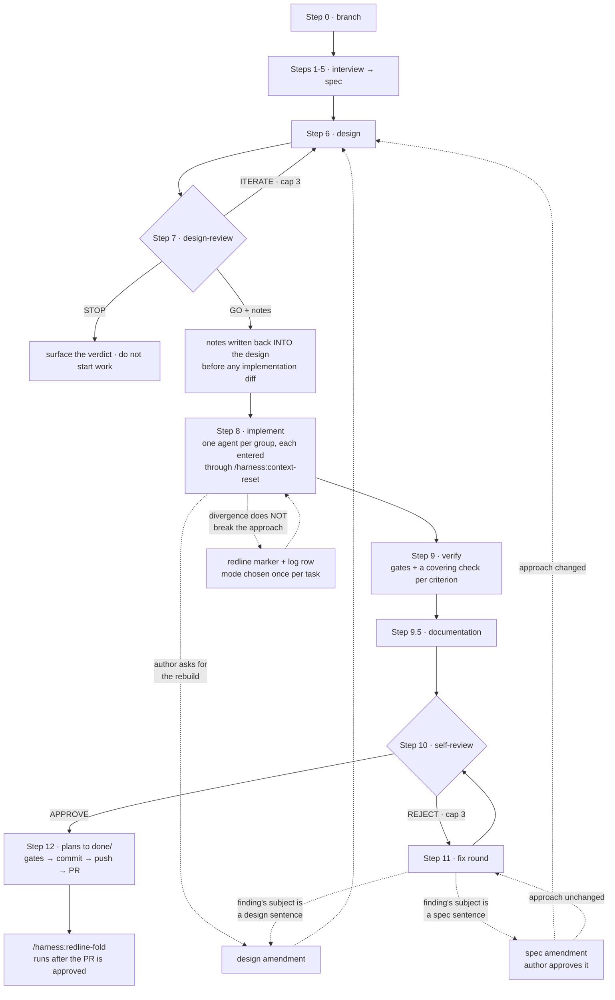
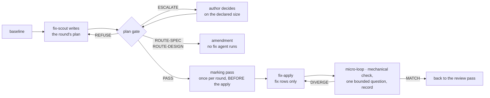

# agent-harness

Multiagentic workflow harness — a Claude Code **plugin** carrying a spec-driven task workflow, a reactive
bugfix loop, skeptical review subagents, and enforcement hooks. Install it once, use it in every project;
each project keeps its own context and its own learning log.

Everything in the plugin is **tool-neutral**: git + GitHub for VCS and review, `%PLACEHOLDER%` tokens for
the build, test, format and lint commands each project fills in.

## Install

One-time, per machine:

```bash
/plugin marketplace add JeriC4o/agent-harness
/plugin install harness@agent-harness
```

Skills are namespaced by plugin, so they are invoked as `/harness:task`, `/harness:bugfix`, and so on.

Choose the scope deliberately:

| Scope | Command | Use when |
|---|---|---|
| User | `claude plugin install harness@agent-harness --scope user` | You work across many repos. Hooks that presuppose a harness profile no-op in repos without one, so this is safe. |
| Project | `claude plugin install harness@agent-harness --scope project` | You want the choice committed in `.claude/settings.json` so your team inherits it. |

To pin a version instead of tracking `main`: `/plugin marketplace add JeriC4o/agent-harness@v0.1.0`.

**Requires:** `git`, `gh` (authenticated — `gh auth login`), and `jq`.

## Set up a project

Run once per repo, from the repo root:

```
/harness:harness-init
```

It scaffolds the **profile half** — `AGENTS.md`, `ai-docs/context.md`, the plans/learnings directories,
`.claude/settings.json`, and a `.gitignore` block — then walks you through resolving the commands the
workflow needs, and registers the project in `~/.claude/harness/registry.json`.

Three things it does deliberately:

- **It never overwrites an existing file.** Re-running it on an already-set-up repo is an upgrade, not a
  reset: your hand-edited `AGENTS.md` survives, and a flag you omit does not wipe a value it recorded earlier.
- **It makes you *run* each command before recording it.** A `%BUILD_CMD%` that was guessed and never
  executed is the exact defect the review agents reject, so the setup refuses to invent one.
- **`--scope local` opts a repo out** of any future cross-project learning sweep — use it for client work.

Then fill in what only you know: the overview paragraph and the domain entities in `ai-docs/context.md`.
Leave the rest as placeholders; `/harness:task` appends entities as it discovers them, which beats a cold guess.

Prefer to do it by hand? Copy `templates/project/` into the repo root, replace `%PROJECT_NAME%`, fill the
`§ Build & Test` table in `AGENTS.md`, and append `gitignore.snippet` to your `.gitignore`.

## Daily use

| You want to… | Run |
|---|---|
| Build a feature properly | `/harness:task <ticket-key or description>` — interview → spec → design → review → implement → verify → self-review → commit |
| Fix something broken | `/harness:bugfix <what is wrong>` — reproduces and writes a failing test *before* touching the fix |
| Plan without building | `/harness:interview` — produces a spec, parks it in `ai-docs/plans/deferred/` |
| Review a whole branch | `/harness:project-review` |
| Clean up after a merge | `/harness:pr-merged` — from the merged branch |
| Check the profile is still sound | `/harness:ai-audit project` — placeholders, dead commands, registry, gitignore |
| Turn repeated corrections into rules | `/harness:improve` — when ≥3 unescalated entries have piled up |
| Audit the instruction files themselves | `/harness:ai-audit` |
| See where a session's tokens went | `scripts/trace-tokens.sh <session.jsonl>` — per-turn and per-skill spend |
| Find out why a run went in circles | `/harness:inspect` — loops, gates re-run with nothing changed, review rounds that burned their cap |
| Check the ticket tail is not outrunning delivery | `scripts/backlog-metrics.sh` — tickets opened per PR merged, and whether they arrive in bursts or as a drip |
| Report a harness defect from the project that hit it | `/harness:report-defect` — drafts a report, runs it through the redaction gate, and files it upstream only after you approve the text |

What accumulates in the repo as you work: specs and designs in `ai-docs/plans/` (moved to `done/` on
completion), and corrections in `ai-docs/learnings/<user>-<branch>.md`. **The learning log is per project
and committed with the code** — lessons from one repo never leak into another.

### Where the tokens went

```bash
${CLAUDE_PLUGIN_ROOT}/scripts/trace-tokens.sh "$(ls -t ~/.claude/projects/*/*.jsonl | head -1)" --top 10
```

Reads a session transcript and reports spend per turn and per skill. **Three numbers, never one:**
`fresh` (input + output) is what the work cost; `cache_read` is context re-read volume, which is a
*loop* signal rather than a cost signal — on a real session it ran 150M against 580k fresh, so
summing them into a single "tokens" figure buries everything actionable; `cache_creation` is what was
paid to fill the cache.

Two things it does that reading the transcript naively does not. It **deduplicates by `message.id`** —
one API message is written as several JSONL lines, one per content block, and every line repeats the
full usage object (measured: 1,021 lines for 558 messages, a ~45% overcount). And it reads
**`<session-id>/subagents/*.jsonl`**, which is where subagent spend actually lives; the session file
itself is 100% `isSidechain: false`, so a tracer that reads only it reports subagent cost as zero —
making a turn that spawned five agents look cheap exactly when it was expensive.

The unit is a **turn**, not an inferred "workflow stage". Both stage models were tried against a real
session and both failed: ending a skill's span at the next human turn dumped 95% of spend into
"(no skill)", because the user answering `/task`'s own questions ended the stage; ending it at the next
skill invocation instead let one skill absorb 392 messages of unrelated later work. A turn boundary is
the one thing here that is not a guess. Skill labels come from the runtime's own attribution, which is
exact but sparse, so the untagged remainder of the *same turn* is reported separately as `carried` —
an inference is never printed as a measurement.

It emits counts, skill names, timestamps and agent ids only — never transcript content.

### Why a run went in circles

```bash
/harness:inspect            # or: /harness:inspect <session.jsonl>
```

Reads a finished session and reports where the **harness** misbehaved — as opposed to `/harness:ai-audit`,
which reads what the instructions *say*, and `self-review`, which reads a diff. A rule can be perfectly
written, perfectly propagated, and still send the agent round in circles; that defect is invisible to both
and visible here.

`scripts/session-events.sh` reduces the transcript to an event stream — tool name, one-way argument
fingerprint, turn, skill, error flag — so the `inspector` agent starts from a few hundred lines instead of
thousands. It then reads the run itself where those lines point: whether a repetition was a loop or a retry
depends on what happened in between, and that is in the transcript rather than in the counts.

`scripts/loop-metrics.sh --for <session.jsonl>` adds the other half — what the live loop cascade saw and
decided *while the session ran*. Without it the inspector re-derives everything from scratch and cannot tell
a detector hit from a detector miss, which is the only feedback the thresholds ever get. It is also a wider
view: the ledger records calls made inside spawned agents, whose transcripts the reduction pass never opens.
Its `gates` block counts the gate record's two signals for the session: a check re-run over an unchanged
tree, and one check answering both ways about one unchanged artefact.

`scripts/human-findings.sh` counts what a person raised after the automated review passed — each comment
posted on the pull request and each fix commit pushed after it opened, the closing fold, version bumps and
merge commits excluded. Push times come from the hosting site's push-activity record, never from commit
dates, and a pull request older than that record's reach is reported as not computable rather than as
zero. `/harness:inspect` runs it for the session's branch; it also runs on demand:

```bash
${CLAUDE_PLUGIN_ROOT}/scripts/human-findings.sh --pr <n>
${CLAUDE_PLUGIN_ROOT}/scripts/human-findings.sh --merged --limit 30   # tally; says when it is partial
```

It needs `gh` and the `**Version-bump paths:**` line in `ai-docs/context.md`.

**Loop-shaped is not loop.** Every repetition signature carries a *time* qualifier (the repeats fall inside
one window); `repeated-tool-call` also carries a *state* qualifier (no `Edit`/`Write` in between — re-running
a gate after changing a file is the workflow working). Every repetition row reports which qualifiers
actually ran on it and at what threshold, so a reader never has to assume — the depth, deferral and
step-regression signatures carry no such fields, because no qualifier beyond their own detection rule
applies to them. Thresholds were calibrated against real sessions rather than guessed: the depth factor
defaults to 5× the median turn because 3× flagged one turn in five, which is a list nobody reads.

Two things it will tell you that a quieter tool would not. **A signature that could not run says so** — the
`current_step` checks need progress-file writes, and a session without them reports `unavailable`, never a
silent zero, because a silent zero is indistinguishable from clean. And **the inspector proposes, it never
edits**: findings become Learning Log entries with `Escalated? no`, and escalation stays with
`/harness:improve` across accumulated evidence. Fixing the rule in the same breath as judging it is grading
your own work.

### Is the backlog growing faster than the work ships

```bash
${CLAUDE_PLUGIN_ROOT}/scripts/backlog-metrics.sh
```

An agent that cannot make a task converge has a cheap way out: file a ticket and move on. Deferring costs
less than admitting the thing did not work, so the tail grows.

The difficulty is that **a growing backlog is also what a healthy project start looks like** — scope
genuinely expands as the work is understood. Growth alone therefore means nothing, so four signals are
reported rather than one score:

| Signal | Deferral | Healthy scope growth |
|---|---|---|
| **ratio** — tickets opened per PR merged | sustained above 1 | below 1 |
| **cadence** — bursts vs drip | filed one at a time, during implementation | filed together, in a planning pass |
| **age** — median age of the open tail | only climbs | churns |
| **volume** — opened vs closed | opened only | both move |

The session-side companion is `deferral-candidate` in `/harness:inspect`, which flags a ticket filed from
inside a turn that had already gone round and round. This script sees whether that has become the habit.

It prints no verdict and no score. Deferral is a **shape over time**, and a single run is a snapshot that
cannot tell parking work from week one of a project — every run says so in its own output.

## Update

Moving an installed copy to a newer version takes **two** commands, in this order:

```bash
claude plugin marketplace update agent-harness
claude plugin update harness@agent-harness
```

The first refreshes this machine's local copy of the marketplace catalog; the second is the one that
moves the installed payload.

**`claude plugin install` is not an upgrade path.** Against an existing installation it short-circuits,
prints `✔ Plugin "harness@agent-harness" is already installed (scope: user)`, and exits 0 — a success
message with the payload untouched. `claude plugin marketplace update` on its own refreshes catalog
metadata and nothing else. Run together they read like an upgrade and are not one.

`update` applies to the scope you installed into and defaults to `user`. If you installed with
`--scope project`, pass `--scope project` here too.

**Then start a *new* session.** Two different things get called "restarting", and only one of them
picks up a new plugin version:

| What you do | What it picks up |
|---|---|
| Resume a session (`claude --resume`) | your **project profile** — `AGENTS.md`, `ai-docs/` — re-read on resume |
| Start a **new** session | the **plugin** — skills, agents and hooks, at the newly installed version |

A resumed session keeps the plugin version it started with, however many times it re-reads your project
files. `claude plugin list` reports the new version as soon as the update lands — but that is a statement
about the cache on disk, not about the session you are sitting in. The only confirmation that a session
is running the new version is that the session was started after the update.

Your project profile is untouched by an update — it lives in your repo, not in the plugin. If a new
harness version adds template files, `/harness:harness-init` picks them up on a re-run without disturbing
anything you have edited.


## The split: method vs profile

| | Ships with the plugin | Supplied by each project |
|---|---|---|
| **What** | How to work: workflow steps, review checklists, search discipline, Learning Log contract | What is true here: build commands, language, domain entities, permissions |
| **Where** | `docs/`, `skills/`, `agents/`, `rules/`, `hooks/` | `AGENTS.md`, `ai-docs/context.md` |
| **Referenced as** | `${CLAUDE_PLUGIN_ROOT}/docs/…` | repo-relative `ai-docs/…` |

That second row is the whole trick. Method paths are absolute-by-variable, so they resolve wherever the
plugin is installed; data paths are repo-relative, so they resolve against **whichever project is open**.
A globally-installed skill writing `ai-docs/learnings/<user>-<branch>.md` therefore writes into the
current project — **per-project learning is a property of the addressing, not a feature to build.**

## Layout

```text
.claude-plugin/
  plugin.json              manifest
  marketplace.json         this repo as its own marketplace
skills/<name>/SKILL.md     the 9 workflows below
agents/<name>.md           the 8 subagents
rules/ast-index.md         code-search hierarchy, inherited verbatim by subagents
hooks/hooks.json           the 12 hooks (hooks/lib/ holds the shared guard)
scripts/                   utility scripts shared by more than one skill
docs/
  agents-method.md         the method rule surface, read at session start
  workflow.md              git/GitHub command map, PR shape, reading a test result
  code-style.md            language-neutral code style
  doc-convention.md        when a doc-comment is written, and its shape
  templates/               canonical .progress.md and Learning Log entry formats
templates/project/         what a consuming project gets scaffolded with
ai-docs/                   this repo's own profile + plan/learning data
```

## Workflows

| Skill | What it does |
|---|---|
| `/harness:task` | The full loop: interview → spec → design → design-review → implement → verify → self-review → commit. Steps are strictly ordered. |
| `/harness:bugfix` | Reactive: trace → root cause → failing test → fix → self-review. Test before fix, always. |
| `/harness:interview` | Requirements interview that produces the spec. Invoked by `/harness:task`, or standalone for spec-only work. |
| `/harness:context-reset` | Group handoff for large tasks, and the compaction-recovery protocol every orchestrator re-enters through. |
| `/harness:project-review` | Whole-branch review: findings table → fix loop → self-review until APPROVE. |
| `/harness:pr-merged` | Post-merge cleanup: switch to the default branch, pull, drop the branch's progress files, delete the branch. |
| `/harness:improve` | Folds merged learning files into the archive, finds repeating corrections, proposes rule escalations — and drafts promotion candidates for lessons that are about the method. |
| `/harness:improve-global` | Run in the harness repo: sweeps candidates across every registered project and promotes a rule once ≥2 of them hit it. |
| `/harness:ai-audit [global\|project]` | Audits an instruction surface: `global` checks the harness method files; `project` checks your profile — unresolved placeholders, commands that do not resolve, registry coherence, candidate hygiene, gitignore coverage. Detects the surface if you omit it. |
| `/harness:harness-init` | Scaffolds the project profile and registers the repo. Run once per project; idempotent. |
| `/harness:report-defect` | Files a defect in the *harness* from the project that hit it: drafts a report into `ai-docs/feedback/`, runs it through `check-candidate.sh --mode report`, shows it to you, and only then files it against the repository named in the installed manifest — so a fork files against itself. A local ledger stops the same defect being filed twice. |
| `/harness:redline-fold` | Run after a PR is approved: applies the task's redline corrections log to the design items that diverged, collapses the spec to its record of deliberate absence, and removes the log. The one step that makes the planning documents describe what shipped. |
| `/harness:inspect` | Reads a finished session and reports where the harness wasted effort — loops, gates re-run without a state change, review rounds that burned their cap. Proposes learning entries; never edits an instruction file. |

Subagents, all ten: `spec-writer`, `design`, `design-review`, `self-review`, `review-findings`,
`self-improve`, `learnings-escalation-audit`, `inspector`, `fix-scout`, `fix-apply`. Re-derive with
`ls agents/*.md` rather than trusting this line — the install smoke gate asserts the installed list covers
every agent the tree ships, so a stale count here is invisible to it.

### What `/harness:task` actually looks like

The table above calls it a loop with ordered steps, which is true and hides the shape. It is **two nested
loops plus re-entrant amendment paths**, and the paths are where a human decides.



Three things the one-line description leaves out.

**A cap bounds the loop, not the gate.** `ITERATE` and `REJECT` each stop at three rounds. When a cap burns,
the open findings go to the author and the loop ends — but fixes made afterwards still get one review pass.
So three rounds means "three rounds, then a human decides, then one more pass", never "stop checking".

**The dotted edges are the only places the flow turns**, and each one is a human decision: whether a
divergence from the frozen design breaks the agreed approach, and whether a finding's subject is a sentence
in the spec. A finding is routed by its **subject**, not by where its fix would land — choosing the remedy
first is what defeats that routing.

**Step 11 is not a step.** It is a six-beat sequence with a mechanical gate in the middle, and the
orchestrator never applies a fix in its own context:



The marking pass runs **before** the apply because its verb asserts the design carries each divergence's
marker and the log its row — asserted after the apply, it would be measured against a tree that does not
hold it yet.

## Releasing

The plugin cache is keyed by **version**, so an installed copy only refreshes when
`.claude-plugin/plugin.json` carries a version it has not seen. A fix shipped without a bump reaches
nobody — `/plugin marketplace update` will refresh the marketplace metadata, report success, and leave the
old payload in place.

**Bump the patch version in the same PR as any change to plugin-loaded content** — `skills/`, `agents/`,
`rules/`, `hooks/`, `docs/`, `scripts/`, `templates/`. A change confined to `README.md` or `ai-docs/`
(this repo's own profile) does not ship to consumers and needs no bump.

Consumers update with the procedure in [§ Update](README.md#update): `claude plugin update`, then a new session.

## Developing the harness itself

This repo consumes its own method file directly ([`docs/agents-method.md`](docs/agents-method.md)) rather
than through an install, so edits take effect without reinstalling. To exercise it as a real plugin:

```bash
claude --plugin-dir /Users/jc/projects/agent-harness
```

There is no build. `bash scripts/run-checks.sh` runs the whole pre-commit gate list in one call and
reports a verdict per member; it derives the suite list from the tree and cross-checks it against the
list `AGENTS.md` names — in both directions, for the test suites and for every structural check that
section spells as a script invocation — so a script-backed gate can be neither documented and never
wired in, nor wired in and never documented. The
gate is nine structural checks — JSON manifests parse, every relative link and
anchor resolves, every `${CLAUDE_PLUGIN_ROOT}` path exists, `bash -n` on every script, this README
documents an update procedure that actually updates, the propagation reminder's path arms still agree
with the Propagation Rule table they are derived from, and the base principles of a spec and a design are
intact with nothing in the instruction corpus contradicting one or adding a required element, and the
shipped method files name no project's stack while no file carries another codebase's identifiers, and
every file that loads whole at agent start keeps its size headroom — plus
three
delivery gates:
`scripts/test-install-smoke.sh` installs the working tree into a throwaway config and requires the plugin
to actually load, `scripts/check-release.sh` refuses a branch that changed shipped content without a
version bump, and `scripts/test-upgrade-smoke.sh` runs this README's own update commands against a
lowered install and requires the payload to move. See [`AGENTS.md` § Build & Test](AGENTS.md#build--test).

Inside a work loop the runner takes `--only <member>[,<member>…]`, naming members as `--list` prints them:
it runs just those, prints the selection, and says the full list was not run. Which members a change
selects is the touched-scope rule in [`docs/check-scope.md`](docs/check-scope.md); the full list runs once,
unnarrowed, after review approves.

## Design notes

- **Fail-loud rules, soft patterns.** Prohibitions are AXIOMs with a trigger table; validated approaches
  are `## Patterns` blocks with soft verbs. [`docs/agent-writing-style.md`](docs/agent-writing-style.md)
  is the style contract for both.
- **One writer per artefact.** The orchestrator never writes `*.spec.md` / `*.design.md` — the owning
  subagent does. Violating that is how transcribed-instead-of-written docs drift.
- **Durable state survives compaction.** Every orchestrator carries a compaction-recovery callout at the
  top of its body and a `.progress.md` on disk, so a truncated session re-enters where it left off.
- **The Learning Log is append-only, and per project.** Corrections go to
  `ai-docs/learnings/<user>-<branch>.md` in the project they happened in. Escalating a lesson into the
  *harness* — where it would change behaviour for every project — is deliberately a separate act: the
  lesson must first be abstracted into a **promotion candidate** that passes a mechanical redaction gate
  (no repo name, ticket key, entity, path or URL), and `/harness:improve-global` promotes it only once
  **two distinct projects** have hit the same thing. The sweep reads candidates and nothing else, so the
  boundary is a file selector rather than an instruction to be careful.
- **Hooks catch what prose cannot.** Branch protection, gate-masking (`| tail` on a test run), learnings
  auto-staging, propagation reminders — see [`hooks/hooks.json`](hooks/hooks.json). Hooks that presuppose
  a harness profile are guarded and no-op elsewhere; hooks that encode pure method (do not mask a gate,
  do not scan `$HOME`) hold in every repo by design.

## Roadmap

The build-out is complete: the method/profile split, plugin packaging, project bootstrap, cross-project
learning, the audit's two surfaces, hook guards, and three delivery gates.

**Next, in this order and for this reason** — each earlier item makes the next one measurable rather than
intuitive:

| # | Issue | Why it comes when it does |
|---|---|---|
| 1 | [`GH-13`](../../issues/13) — trace token spend per workflow stage | **Shipped** as `scripts/trace-tokens.sh`. Produces the cost signal the inspector needs. |
| 2 | [`GH-14`](../../issues/14) — inspector subagent for workflow loops | **Shipped** as `/harness:inspect` (`scripts/session-events.sh` + the `inspector` agent). Reports where the *harness* misbehaved: loops, gates re-run with nothing changed, caps burned without converging. |
| 3 | [`GH-15`](../../issues/15) — vector/RAG index over code | **Filed with a recommendation against building it as stated**, and a smaller reframe that keeps the value. Deliberately last: `GH-14`'s job is spotting where search actually wasted turns, which turns this from an intuition into a measurement. |

Validation work, waiting on real use rather than on code:
[`GH-10`](../../issues/10) (the ≥2-projects threshold has never met a real corpus) and
[`GH-11`](../../issues/11) (`/harness:improve` Step 5b has never produced a candidate on a real log).
