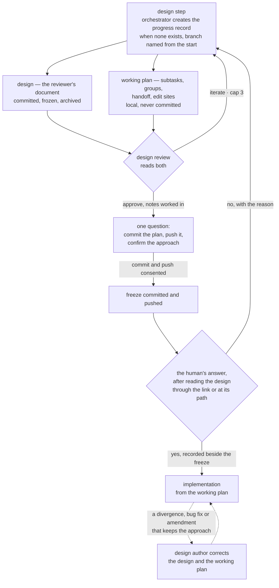

# Design: Split the design into the human's review document and the agents' working plan

**Ticket:** GH-174
**Date:** 2026-10-30
**Spec:** ai-docs/plans/2026-10-30-split-design-reviewer-working-plan.spec.md

## Approach

The design stops carrying the executor's detail and becomes the page a human reads to judge an approach.
The subtasks, the order of the implementation groups, the handoff between them and the places each subtask
edits move into a new section of the task's local progress record, written by the same party that writes
the design and by nobody else. Everything that checks a plan learns to tell a design written before the
change from one written after it by the design's own content, so a task already in flight finishes in the
shape it started in. The existing plan-convergence check gains a reading that measures a new-shape design
against a soft length cap and reports the figure wherever the check already runs; it refuses nothing and
holds nothing, and the human sees the figure in the confirmation question and, after a correction that
leaves the design over the cap, in the pull-request description. After design review approves, the human
is asked one question covering committing the plan, pushing it and a "yes" on the approach, and
implementation waits for that "yes".

### What each document holds

**The design**, under the new rules, holds six sections: `## Approach`, which carries the diagram of the
approach in the form the project's `AGENTS.md` § VCS names; `## Key decisions`, each decision with the
alternatives it rejected; `## Risks`; `## Use cases`, one entry per object the task builds; `##
Collisions`, naming each second definition the change introduces of something already defined and each
piece of work in flight the change breaks, or `None.`; and `## Open questions`. It holds no decomposition,
group order, handoff or edit sites, and nothing that only the implementation's changes could supply. Its
register is the human reader's: a criterion, a file or a symbol may be named, but never in place of saying
what it is or does. `## Key decisions` reuses the spec's heading on purpose: one section name already
serves both documents, `## Open questions`, and a name the record already carries adds no new word to the
edit-time refusal's vocabulary, where a fresh name such as "Decisions" would also match every mention of
the progress record's `## Decisions log`.

**The working plan** is a new section of `<spec-base>.progress.md`, the `## Working plan`, with two parts:
a subtask table — number, subtask, edit sites, the criteria it delivers, what it depends on — and the
groups, one line each, naming the subtasks in the group and the handoff into it. On a task whose design is
in the new shape the subtask table is the one subtask list, and the record carries no checkbox list of
subtasks; a record begun under the earlier shape keeps its checkbox list, and resumption reads its
progress there; the whole-branch review's record keeps its own. Its format is stated once, in
`docs/templates/progress-format.md` § Working plan, and the design contract points there rather than
showing a second copy — a template block inside `agents/design.md` would be read by the element derivation
as part of the design's own required composition.

**Who writes it.** The design author writes the working plan when it writes the design, rewrites it on
every design-review iteration, and works a design-review note about it in before the freeze, as it does a
note about the design. After the freeze its in-place correction pass corrects the working plan on every
occasion that falls while a group is still left to run — after a group that recorded a divergence, after a
bug fix run inside implementation, and after an approach-keeping spec amendment that interrupted a
subtask — and the occasion table of `agents/design.md` § Correcting the design in place names the working
plan on those three. On the occasions after the last group — a review-and-fix round, a follow-up round on
the open pull request, and a bug fix or amendment inside either — no group reads it again, so it stands as
it is, and what the round changed is held by version control and the round's own findings. Nobody else
edits it: the per-group implementation agents read it and write their progress elsewhere, and the
fix-round planner never names the progress record as a fix target.

**Marking a subtask done** writes a new section, the `## Completed subtasks`, one line per closed subtask
with the commit that closed it, written by whoever closes the subtask — the orchestrator or the group's
agent, the parties that tick a box today. Resumption takes the first subtask of the working plan, in its
order, that has no line there. `**current_step:**` keeps its "subtask N of M" value as the cross-check it
already is, but cannot be the record by itself: two groups the working plan shows independent may run at
once, and then "N of M" is not a position in one list.

### Telling the two shapes apart

A design carrying a level-two `## Decomposition` heading is in the earlier shape; every other design is in
the new one. This `design shape test` needs no marker and no date: every one of the 17 archived designs
carries that heading (measured with `grep -c '^## Decomposition'` over `ai-docs/plans/done/*.design.md` on
this branch), and a design begun before the change has it because the template it was written from had it.
Every reader that looks for subtasks or groups applies the test and treats the earlier shape as it does
today: the length cap, the register rule and the two sections the new template adds do not apply to it,
its decomposition and handoff plan are read in the design and its progress in its record's checkbox list,
and its author amends and corrects it in the shape it has. The confirmation and the pull-request
description's link to the design apply to the new shape only, so a task begun before the change finishes
under the rules it started under. No design of a task already in flight is measured against the length cap
or refused for its shape.

### The length cap

The cap is 5,000 characters, a threshold the owner set in the spec, over the design's text with the
diagram's notation not counted. It is a soft limit: the design author aims at it when it writes a new
design, and nothing refuses, holds or hands back a design for running over it. The `length reading` of
`scripts/check-plan-convergence.sh` measures it, in the core, `scripts/check-plan-convergence.py`, beside
the `design shape test`.

- **What it counts.** Characters as code points, the unit the method's own size rule uses. Inside a fenced
  block whose tag is the diagram form the profile names, only label text counts: text between a pair of
  double quote marks, brackets, parentheses, braces or vertical bars, and text after a colon to the end of
  its line. Identifiers, arrows, keywords and layout are notation and are not counted. Everything outside
  such a block counts, the use cases included. The rule is stated over shapes common to text diagram
  notations because a method file may not name one; where it cannot tell, it counts, so a block with no
  closing fence is counted whole.
- **Where the diagram form comes from.** The `Diagram form` row of `AGENTS.md` § VCS, renamed from
  "PR-description diagram form" because it now also governs the design's diagram. The fence tag is the
  row's first backticked span, or, where the row carries none, the first word of its value in lower case —
  its leading run of letters, digits and hyphens, so a value opening "Mermaid," or "Mermaid —" yields the
  same tag; this repository's renamed row carries the tag backticked. A row under the old name is read the
  same way, so a consuming project whose profile predates the rename still has its diagram excluded. The
  row's wording widens to say the form also renders in a committed Markdown file, which for GitHub is
  claimed and is verified when the row is written. With no such row, nothing is excluded and the reading
  says so. The profile is committed, so every clone measures the same.
- **It reports, and only reports.** On a new-shape design, wherever it sits, the core's `roster()` prints
  the reading as its last line: the
  measured length beside the cap, with "over the cap" when it is over. On an earlier-shape design the line
  says it was not measured, and why. The reading is not a class: it raises no finding, so it changes
  neither the exit status nor any count, offers nothing to excuse, and leaves the classes, and which of
  them hold a plan, as they are, so no sentence counting them moves. Design review reports the figure in
  its verdict and never raises it as an issue.
- **Where the human sees it.** The design author's hand-back carries the line on every write of the design,
  the in-place correction included. The human sees the figure in the confirmation question, whose "yes"
  accepts the design at that length, and, after a correction that leaves the design over the cap, on the
  pull-request description's line on the design's change since approval; § The confirmation and § The
  pull-request description say how.
- **Correction after the freeze.** A correction is made in the item it falsifies, only as far as the
  shipped work needs, even when it takes the design over the cap. It shortens no item the divergence did
  not falsify, the design's length is never a finding the author must resolve or a reason to hand it
  back, a correction that keeps the approach never becomes a new design for its length, and no new
  confirmation is asked.

### What each check reads

| Reader | Reads | Earlier-shape design | New-shape design |
|---|---|---|---|
| plan-convergence check, completeness | spec, design | as today: its decomposition rows deliver every criterion, and every built path they mark and every use-case object has its place, reason and cases | criterion delivery, stated place and the built-path leg are reported not applicable, counted in the roster; each use-case object's reason and cases still checked |
| plan-convergence check, length reading | design, profile | not measured | measured wherever the design sits, and reported; holds nothing |
| plan-convergence check, provenance | spec, design | as today: every figure's clause names its kind, and a figure sharing a clause with a built path is reported | every figure's clause still checked; the built-path leg is reported not applicable in the class's roster line |
| declared-link check, plan-convergence reader | spec and design, as today | unchanged | unchanged |
| design review | design, working plan | reviewed as today | both reviewed; a missing working plan, or a criterion no subtask delivers, withholds approval |
| self-review | design, working plan, progress record | its decomposition read in the design | the working plan's edit sites read against the changed files and the decisions log; with no working plan — a post-push round on another machine, a deleted record — files conformance is read from the design, and from the decisions log where the record survives — in both cases named, the design alone — and the absence raises no finding |
| per-group implementation agents, resumption | progress record | the design's own decomposition and handoff plan, and the record's checkbox list | the working plan and the completion lines |

Completeness keeps reading an earlier-shape design's decomposition after `## Decomposition` and `##
Handoff plan` leave the record of required elements. Two functions slice a design by the record's headings
today: `completeness()` in `scripts/check-plan-convergence-holding.py` [completeness-slice], for the rows
and their delivery cells, and `built_paths()` in `scripts/check-plan-convergence.py` [built-path-slice],
which collects the paths a row marks as new and hands them to completeness and to provenance as the built
set. Dropping the two headings would leave an in-flight design's rows unread, every criterion reported
undelivered, and every built path gone without a word, its `built=0` reading the same as a design that
marks nothing. The core, `scripts/check-plan-convergence.py`, therefore holds the earlier shape's two
section names as data beside the `design shape test`, has `built_paths()` read an earlier-shape design by
them as well as by the record, and passes the shape and the two names to the holding payload through
`CONTEXT` in `scripts/check-plan-convergence.py` [convergence-context], the one mapping both payload
siblings unpack; the payload holds no section name of its own. On a new-shape design no ordinal table is
read as a decomposition, wherever it sits, and no built set is collected, because the edit sites live in
the working plan. The provenance class's roster line, which `roster()` in `scripts/check-plan-convergence.py`
[convergence-roster] composes, then says its built-path leg did not apply, so an empty built set on a
new-shape design is not read as a design that marks nothing.

The two names are written as plain quoted strings in an ordinary assignment — no backticks, no shell-style
list assignment, outside any markdown-tagged block — so none of the three shapes the coverage sweep in
`scripts/check-plan-invariants-refusal.py` reads as a locus matches them, and the core does not read as
enforcing an element while both are still record names, between subtasks 1 and 2, or after. The core's
header, which says the file holds no section name as a literal, is the one the two names make false as
worded, and it is reworded to name what it protects: no name the record of required elements carries
appears in the file in a shape that sweep reads as defining or enforcing an element, and the earlier
shape's two names are the one set it holds, as data. The holding and reporting payloads' headers keep
their restatement as worded, because each still holds no section name and the condition they quote from
the core is unchanged.

No check other than design review that can refuse the design author's hand-back reads the progress record,
and the absence of a working plan is never a could-not-run anywhere outside design review. Design review
holds the plan on the working plan before the freeze, and judges there that every criterion is delivered by
some subtask. After the freeze that judgement falls to the design author's correction pass whenever an
approach-keeping spec amendment adds or changes a criterion while a group is still to run. The Spec
Amendment recipe's third act, which names a criterion the amendment added that no decomposition row
delivers as a false design statement, names on a new-shape design every criterion the amendment added or
changed while a group is still to run, so its fifth act spawns the correction pass with each; the pass
places each in a subtask of the working plan, or names the subtask already delivering it, and its
hand-back lists each with its subtask. No design review runs on that branch, as today, and self-review
reads the shipped work against every criterion before it is committed.

### The progress record from the design step

The orchestrator creates the progress record as Step 6's first action when none exists, before it spawns
the design author, writing the header fields it writes today except `**base_commit:**` — `**Branch:**`
among them, so the post-merge cleanup, `skills/pr-merged/scripts/cleanup-progress.sh`, which finds the
record by an exact `**Branch:**` line, finds it from the design step on. The design author adds only the
`## Working plan`. Step 8 still creates the record when none exists, for a task begun before the change,
and writes `**base_commit:**` either way: it is taken at implementation start, after the confirmed freeze,
so the record carries none before then. On every later entry into Step 6, after an ITERATE or a "no", the
orchestrator neither recreates nor clears the record: the working plan, the design-review notes and the
decisions log stand, the design author rewrites the working plan, and each step adds the outputs the
recorded-step table below names before it is marked done. Before implementation a boundary rewrites
`**current_step:**` alone: `**last_passed_gate:**` stays `(none yet)` and `## Next action` stays empty, the
progress format's rule rewriting both at every boundary binding from implementation start, and resumption
of a record without `**base_commit:**` reads neither.

**The recorded step.** Before implementation `**current_step:**` names the last step marked done, as its
"subtask N of M complete" value already does during implementation. The orchestrator marks a step done
only after the step's outputs are written, so the record never runs ahead of its data:

| Step marked done | Its outputs, written first | The task goes on to |
|---|---|---|
| none yet, the state the record is created in | — | the design step |
| design | the design; on the new shape the `## Working plan` | design review |
| design review, round N, ITERATE | the verdict's issues, verbatim, under `## Design-review issues (Round N)` | the design step, which revises against them |
| design review, round N, GO | the verdict's notes, as that approval's table in `## Design-review notes` | the design author working the notes in |
| notes worked in | the last column of every row of that table, filled by the orchestrator as it finds each note in the design or the working plan; a note it cannot find goes back to the design author first | the one question; on the earlier shape the freeze |
| freeze | the freeze commit, and its push where the question asked for one | the answer, asking nothing about a commit; on the earlier shape implementation |
| confirmation | `**confirmation:**` `yes` with the freeze's id, or `no` with its reason in the decisions log | on `yes` implementation, which writes `**base_commit:**`; on `no` the design step, the reason carried to the design author |

Each approval's notes are a table of their own, under a line naming the round that approved, appended
below any earlier approval's, so a second approval after a "no" leaves the first one's record intact;
Step 8's first action, self-review and resumption read the last table. Step 8's first action still
confirms the fold-in, which on a task the orchestrator already checked finds every row filled.

**Re-entry.** The active-task check validates a record that carries no `**base_commit:**` against the
plan's freeze instead, when `scripts/plan-freeze.sh find` names one. Only `find`'s no-freeze reason — no
commit reachable from the head carries the plan's freeze trailer — reads as no freeze, and then nothing of
the task can have merged and only the branch is matched; any other could-not-compute is a STOP put to the
user, as Step 8's first action already treats one. A record created before implementation therefore
passes validation, and the delete option, offered only on a mismatch, never reaches its working plan. A
record carrying `**base_commit:**` has reached implementation and resumes as today, from `## Next action`,
a new-shape record at the first subtask with no completion line.

A record without `**base_commit:**` resumes from the step it records, validated backwards. The recorded
step is checked first — it finished, and its outputs are present and intact — and on a failure the step
before it, and so on back to the first step that passes; the task resumes right after that step, and at
the design step when none passes. The artefacts never carry the resume point past the step after the
recorded one: they only refuse a resume point whose preconditions they do not show. A step passes only
while the earlier outputs it depends on still hold, not its own alone: every step after the design step
needs the design and, on the new shape, the working plan — so a missing working plan fails every step back
to the design step, as the spec requires of a task re-entered without it; a freeze, and a `yes`, pass
only while `plan-freeze.sh diff` shows the plan unchanged since that freeze, and a `yes` only while it
names the freeze `plan-freeze.sh find` names; a `no` needs only its reason in the decisions log, because
the redesign it starts changes the design. Where the step that passed is not the recorded one, the user is
told which output was missing when the task resumes. The record is read end to end before any of this, as
the group handoff's re-entry invariant requires of a recorded step. That invariant, in
`skills/context-reset/SKILL.md`, and the task flow's compaction-recovery callout, in
`skills/task/SKILL.md`, each call the recorded step a cross-check, the first a hint as well; both are
reworded to say that before implementation the recorded step is where this backward validation starts,
that during implementation it stays a cross-check, and that either way the record is read end to end
first.

The two cases a crash before implementation most often leaves come out as follows. A task whose redesign
after a "no" is under review has the design marked done; that step passes, so it resumes at design review,
and the earlier approval's notes, which stand in the record, are never consulted, because validation only
runs backwards from the recorded step. A task whose design is being revised after an ITERATE has that
verdict marked done; its issues are in their section, so it resumes at the design step, which revises
against them. A step whose outputs landed before a crash left it unmarked runs again over them: the
fold-in check finds each note already worked in, and the question finds the plan unchanged since a freeze
and asks only for the push the freeze may lack, where one is asked, and for the answer. A record with no
`**base_commit:**` that names none of these values was written under the earlier rules, by Step 7 for its
notes, and is read as recording the approval.

**Without a record.** The planned-but-unstarted check, which finds a committed spec and design with no
record, routes an earlier-shape design to design review as today, and a new-shape design to the design
step for a new design, design review, freeze and confirmation: its working plan was local and is gone, and
nothing implements from the design alone. The deferred-plan activation already goes to the design step
when no record comes with the plan.

### The confirmation

After design review approves, the design author has worked the notes in and the orchestrator has found
each of them in the design or the working plan, the orchestrator asks the `confirmation question`, once
per approval that takes a freeze, on every task whose design is in the new shape. In plain words it says
that the agreed plan will be committed as the approved plan and pushed to the branch, gives the link to
the design there, states the design's measured length beside the cap, and says what each answer does:
"yes" confirms the approach, at that length, and lets implementation start; "no", with a reason, sends the
approach back to be redesigned.

- **The length** is the `length reading` from the design author's last exit check, which ends every write
  of the design, or, when that hand-back is not at hand, from a run of the check over the design as it
  stands; either way it is the figure for the design at the question. It is stated whether or
  not the design is over the cap, and over the cap nothing more is asked: the "yes" accepts it.
- **The link** is built from the `File link form` row added to `AGENTS.md` § VCS — for this repository the
  review surface's address of a file at a ref — with the branch as the ref. The question is asked before
  the commit exists, so the link cannot name the commit; the branch's head is the freeze from the push
  until the "yes", because nothing is committed in between. Where the row says `none`, or the profile has
  no such row because it was written before this change, the question names the design's path instead,
  for reading where the project's own viewer renders it.
- **The push** is asked whenever the repository has a remote, whatever the row says, because the push
  needs no link form; only the link does. With no remote the question asks to commit and confirm.
- **The usual reply consents to the commit and the push first** and gives the answer after reading the
  design — on the review surface, which a human can do only after the push, or where the project's own
  viewer renders it when there is none: the commit and the push are acted on, and the answer is awaited
  without a second question.
- **The "yes"** is recorded as `**confirmation:**` `yes` with the id of the freeze commit it answered,
  written by the orchestrator. On a new-shape design Step 8's first action requires it to name the freeze
  that `plan-freeze.sh find` names. A new freeze — after a design amendment, or a spec amendment that
  changed the approach — names a different commit, so it is asked again; a correction in place takes no freeze and asks nothing, and the
  working plan is outside every freeze, so changing it asks nothing either; nor does the description's
  line on the design's change since approval ever see it, because `scripts/plan-freeze.sh` accepts a spec
  or a design and no other file.
- **A "no"** goes to the design author as the reason the approach was refused, on the ordinary design,
  design review and freeze route, followed by a new question. The freeze it follows stays in the branch's
  history, and a "no" given before any consent to the commit commits nothing. It is recorded as
  `**confirmation:**` `no`, its reason in the decisions log, and stands until the next answer replaces it;
  once the redesign is marked done, resumption no longer reads it. It does not count against design
  review's round cap: the cap stops two agents circling, and the human ruling is not that.

The method's statement of audience changes with it: a spec is for the model, the design is for the human
who reviews its approach, the confirmation is the one question answered by reading a document through the
link it carries, or at the path it names where the profile gives no link form, and every other question
stays answerable without opening a file.

### The pull-request description

When the task's design is in the new shape, the description links it at the head commit it was written
against — a link to the branch would break once the merged branch is deleted, and the review surface keeps
a pull request's commits under the pull request's own ref (claimed for GitHub; verify when the row is
written) — for the problem, the approach, the decisions and the diagram, restates none of them, and adds
only what happened during implementation: where the work departed from the design and why, and what to
look at in review. The line linking the design's change since approval stays one line however often the
description is rewritten. It is where the human sees a correction's effect on the length: when the design
is in the new shape and over the cap, the line also states its measured length beside the cap, the figure
the `length reading` gives for the design at the head the description is written against — the
correction pass's hand-back carries it, and a run of the check gives it again — and asks for nothing. An
earlier-shape design, and a task with no design, keep today's description, its process diagram included.

### The principles and the record of required elements

Principle 1 names the working plan among the artefacts with one writer: the orchestrator writes neither
the spec, nor the design, nor the working plan, and the working plan is written only by the design's
author. Principle 7 drops its words on a design's process sections and states that the working plan is not
archived, because it is never committed. Each changes with its pinned copy, the `PINNED` list in
`scripts/check-plan-invariants.py` [pinned-principles], in the same subtask. Principle 3, on tests, and
the meaning of "plan" are untouched, and so is principle 4, on correction in place, which stays true of
the cap because the cap never moves a correction out of the item it falsifies.

The record of required elements loses the design's `## Decomposition` and `## Handoff plan` and gains `##
Key decisions` and `## Collisions` for the design. The pages that make a design element required move with
it. In subtask 2, beside the record: the template in `agents/design.md`, and the severity lines of
`agents/design-review.md`, whose handoff item is reworded so it no longer quotes the old heading as an
element beside a severity — the element derivation in `scripts/check-plan-invariants.py` reads such a line
as a design element arriving [severity]. Design review's new working-plan item and its earlier-shape
rubric name those sections the same way, in words and never as a backticked heading beside a severity: a
line giving the working plan's heading a severity in backticks would be derived as a design element the
record does not carry, and the check would report it arriving. `agents/design.md` describes the earlier
shape in prose and shows no markdown-tagged template of it, because the same derivation reads every such
block in that file as the design's required composition and would bring the two dropped elements back. In
subtask 3: the task skill's binding handoff rule and its reference page's gate-checklist row on the
handoff plan, which the protected-page table on `docs/plan-invariants.md` records as making that element
required. Between the two subtasks those pages state a handoff rule naming no recorded element, which no
check reads, because the coverage sweep reads only the names the record and the derivation carry.

The working plan's sections do not join the record as a third document: every reader of the record keys
on a spec or a design row and passes any other row over in silence, so a third row would be a record
nothing checks, and the protections the record exists for — of a composition committed, frozen and
archived — have nothing to protect in a document that is none of the three. The progress-format page stays a near miss for the same reason, and its working-plan template uses
no heading the record carries, because the coverage sweep in `scripts/check-plan-invariants-refusal.py`
reports any page outside the protected set whose template block spells one [defines-element]. The
protected pages stay the six the protected-page table on `docs/plan-invariants.md` lists on this branch:
each keeps a locus — the task skill and its reference through the line requiring the spec's acceptance
criteria before the design step — and the rows naming the loci that leave are rewritten to name the loci
that remain.

### Budget of the three always-loaded files

The task workflow file, the self-review contract and the method file each end no larger than they began,
as the spec requires. Each grows where the flow changes and is offset inside the same file:

- **Task workflow file.** The progress-record field list leaves Step 8 for the shorter Step 6 sentence,
  the confirmation's detail, the recorded-step table and its backward validation go to new sections of
  the skill's reference page, which loads only by link, the planned-but-unstarted preamble's explanatory
  sentence is shortened, and six clauses the file restated from pages that already state them leave it.
- **Self-review contract.** Three lines change, the design read, the files conformance and the notes item
  reading the last approval's table; the offset is taken from the explanatory clauses of its second and
  third instructions.
- **Method file.** The audience sentence of `docs/agents-method.md` § Communication grows; the offset is
  the same file's paragraph explaining why its Test Conventions heading stays, compressed to one sentence.

### Rejected alternatives

- **The cap as a separate script.** It would need its own call at the design step, in design review, in
  the design contract and at Step 7, the last inside the workflow file that may not grow. A reading of the
  convergence check reaches every site where that check already runs.
- **The cap as a new class of the convergence check.** A class raises findings, and every reader of a
  reporting finding, design review among them, weighs it as one, which is the treatment the soft limit
  rules out; every sentence that counts the classes would move as well.
- **Measuring only outside the archive directory.** The task's closing step moves its design there before
  the pull request opens, so a correction on a follow-up round would go unmeasured and the human would
  not see its length.
- **A shape marker or a cut-off date.** An author who omits a marker escapes it, which leaves the same gap
  the content test leaves, at the price of a new header field; a date cut-off refuses an in-flight task in
  a project that upgrades late.
- **The design author creating the progress record.** The header fields would gain a second writer, which
  the spec rules out.
- **Counting only quoted labels.** An unquoted label would escape the count; the delimiter rule catches
  brackets and bars as well.
- **A mechanical refusal of a fix row targeting the progress record.** The fix-round gate already passes
  such a row unseen, but the planner edits nothing but its own plan section and the applier edits only
  what a row names; one sentence in the planner's contract closes the path at a fraction of the cost of a
  new refusal and its reason token.
- **Linking the confirmation to the freeze commit.** The commit does not exist when the question is asked.

## Decomposition

| # | Task | Files | Delivers | Depends on |
|---|------|-------|----------|------------|
| 1 | The convergence check learns both shapes and measures the new one: the `design shape test` and the earlier shape's two section names held as data in the core, in a form none of the coverage sweep's three shapes matches, and passed to the holding payload through `CONTEXT`; `built_paths()` and completeness reading an earlier-shape design by those names as well as by the record, each function, the mapping and `roster()` marked with its id; delivery, place and both built-path legs, completeness's and provenance's, reported not applicable on a new-shape design, provenance's in the roster line `roster()` composes; the core's header reworded to the token set it protects, the two payload headers' restatements kept as worded; the `length reading` with its label rule, measured on every new-shape design wherever it sits and printed as the roster's last line, raising no finding; the `Diagram form` row renamed in both profiles, this repository's carrying its tag backticked | `scripts/check-plan-convergence.py`, `scripts/check-plan-convergence-holding.py`, `AGENTS.md`, `templates/project/AGENTS.md` | AC3, AC4, AC6, AC12 | — |
| 2 | The plan's composition and principles, landed together: principles 1 and 7 with their pinned copy; the record of required elements; the reviewer's template with `## Key decisions` and `## Collisions`, the register rule, and the cap as a soft limit — the author aiming at it, the `length reading` carried in the hand-back, over the cap never a finding to resolve or a reason to hand back, and a correction that takes the design over it shortening no item the divergence did not falsify; the working-plan rules re-pointed — grouping, every criterion delivered by a subtask, the split proposal, the earlier-shape rule stated in prose with no template block; the occasion table of the in-place correction naming the working plan on the three occasions inside implementation, a criterion an approach-keeping amendment adds or changes placed in a subtask there; design review's working-plan, shape and section items, none giving a backticked heading a severity, its length item reporting the reading and never raising it, and its verdict wording; the `## Working plan`, `## Completed subtasks`, `## Design-review issues (Round N)` and `**confirmation:**` in the progress format, with its required fields, its lifecycle — `**base_commit:**` written at implementation start, `**current_step:**` naming the last step marked done before implementation and the only field a boundary rewrites there, the every-boundary rule on `**last_passed_gate:**` and `## Next action` binding from implementation start, each step's outputs written before it is marked done, the checkbox list kept for an earlier-shape record, one design-review notes table per approval with the last one read — and the design-review notes' last column naming a working-plan item as well as a design item, filled by the orchestrator as it confirms the fold-in before the freeze; the protected-table and near-miss rows | `docs/plan-invariants.md`, `scripts/check-plan-invariants.py`, `agents/design.md`, `agents/design-review.md`, `docs/templates/progress-format.md` | AC1, AC2, AC3, AC4, AC6, AC7, AC8, AC11, AC19, AC20 | 1 |
| 3 | The task flow: the progress record created at Step 6 when none exists, otherwise left standing; the Step 6 brief, and Step 7's design-review brief naming the progress record; validation of a record with no `**base_commit:**` against the freeze, only the no-freeze reason read as no freeze; resumption from the recorded step, validated backwards, and the two sentences calling the recorded step a hint or a cross-check — the compaction-recovery callout and the group handoff's re-entry invariant — reworded to match; Step 7 writing an ITERATE's issues and each GO's notes table into the record before the round is marked done, and the orchestrator confirming the fold-in before the freeze; the planned-but-unstarted route by shape; the `confirmation question` after the approval, on every new freeze in both amendment recipes, stating the design's measured length beside the cap, asking for the push whenever the repository has a remote and naming the design's path where the profile gives no link, and its "no"; the Spec Amendment recipe's third and fifth acts sending a criterion an approach-keeping amendment adds or changes on a new-shape design to the design author's correction pass while a group is still to run; Step 8's first action checking `**confirmation:**`; groups from the working plan; `## Completed subtasks` replacing the ticked box on a new-shape task; the gate checklist's handoff row and the skill's binding handoff rule; the group handoff reading the working plan and leaving it alone; the `File link form` row; the freeze page and the per-group correction page | `skills/task/SKILL.md`, `skills/task/reference.md`, `skills/context-reset/SKILL.md`, `AGENTS.md`, `templates/project/AGENTS.md`, `docs/workflow.md` | AC3, AC9, AC10, AC13, AC14, AC15, AC16, AC18, AC22 | 2 |
| 4 | The other readers and the human-facing text: self-review reading the working plan or the earlier-shape decomposition — with no working plan, files conformance from the design, and from the decisions log where the record survives — and the last approval's notes table; the fix-round planner never targeting the progress record; the pull-request description linking the design, its line on the design's change since approval stating the measured length beside the cap when the design is over it; the method's statement of audience and the confirmation as the one question read through its link, or at its path where the profile gives no link form; the docs index, the propagation table's group rows — the working-plan section joining the Task/Design group — and the readme's flow diagram | `agents/self-review.md`, `agents/fix-scout.md`, `docs/workflow.md`, `docs/agents-method.md`, `docs/agent-docs-index.md`, `docs/propagation.md`, `README.md` | AC4, AC6, AC8, AC17, AC21, AC22 | 2, 3 |
| 5 | The `reviewer versions`: a reviewer's version of the smallest and of the largest archived design by character count, use cases and collisions included, written outside the tree and measured with the shipped measurement; both versions and both figures put on the ticket beside the first such exercise, with the owner's consent; when either exceeds the cap, the revised figure put to the owner with both figures before the pull request opens | — | AC5 | 1, 2 |
| 6 | Release: the plugin's patch version bumped | `.claude-plugin/plugin.json` | — | 1, 2, 3, 4, 5 |

**Subtask 1** lands before the record changes, so it changes nothing for any design in the tree: every
design there is in the earlier shape until subtask 2 changes the template. The earlier shape's two names
enter the core in the form § What each check reads names, so the core does not read as enforcing an
element while both are still record names. Its rename of the `Diagram form` row is the only text it
touches outside the check.

**Subtask 2 is one change because the plan-invariants check compares its parts with each other.** The
record, the template, the design-review severity lines and the pinned principle copy disagree for as long
as any one of them has moved alone, and that check reports the disagreement until the last of them lands.
The design-review line that still quotes the old heading beside a severity is the one most easily missed.

**Subtask 3** keeps the workflow file within its budget by the moves named in § Budget of the three
always-loaded files. The working-plan format it points at comes from subtask 2.

**Subtask 4** sweeps the sync groups the edited files belong to: Task/Design, Freeze, Plan-Invariants,
Plan-Convergence, Review, Check-Scope, Human-register and Spec-Amendment, and Scouted-Fix for the
planner's contract. Spec-Amendment brings `skills/bugfix/SKILL.md` and `skills/project-review/SKILL.md`
into the sweep; each changes only where the sweep finds a statement the change has made untrue.
Adding the working-plan section to the Task/Design group changes what the propagation-arms gate derives;
an arm is added to the reminder only if that gate reports one missing.

**Subtask 5** writes nothing into the tree: the `reviewer versions` are evidence for the owner's decision
on the figure, not shipped content. The two archived designs are
`2026-10-21-check-redline-stale-ref.design.md` and `2026-10-06-scouted-fix-plan.design.md`, ranked
smallest and largest by `wc -m` over `ai-docs/plans/done/*.design.md` on this branch. A revised cap
changes a decision the spec records, so it takes the spec-amendment route with the owner's approval, and
the cap's figure in the check and in the design contract moves with it.

## Handoff plan

`M = 6`: two groups, 3 + 3.

- **Group A:** subtasks 1–3 — the checks, the plan's composition and the task flow. Entered through
  `/context-reset` per `${CLAUDE_PLUGIN_ROOT}/skills/context-reset/SKILL.md`, as every group is.
- **Handoff after Group A:** spawn `/context-reset` per
  `${CLAUDE_PLUGIN_ROOT}/skills/context-reset/SKILL.md`. Parent `/task` resumes in Group B with fresh
  context.
- **Group B:** subtasks 4–6 — the remaining readers, the reviewer versions and the release. Terminal group
  (3 subtasks; within the 1..3 range).

The groups run in order: subtasks 4 and 5 read what Group A wrote, and subtask 6 follows everything.

## Risks

- **A new design written in the earlier shape escapes the cap.** The shape is read from content, and a
  design that carries a decomposition is indistinguishable from one begun before the change. The template
  and the design contract are what prevent it; nothing mechanical does, and a marker would leave the same
  gap by omission.
- **A task already in flight in a consuming project when the plugin updates.** Its design is in the
  earlier shape and its record may lack a working plan. Every reader falls back to the design's own
  decomposition and handoff plan, design review applies the earlier rubric, and the cap and the new
  sections do not apply.
- **A record created before implementation broke validation and resumption.** Validation required
  `**base_commit:**`, offering deletion on a failure, and resumption skipped every step before
  implementation. Validation against the freeze and resumption from the recorded step, validated
  backwards, close both, and a fallback below the recorded step is named to the user rather than taken
  silently.
- **A finished step runs again after a crash.** A step whose outputs landed but which was not yet marked
  done resumes as unfinished, because the artefacts never move the resume point forward; the fold-in check
  and the question find their outputs in place and redo nothing, and a design-review round runs once more.
  Committing every step as it is marked done is the follow-up, #180.
- **Losing the working plan.** A task resumed on another machine, or one whose record is deleted, is
  planned again from the design step. The owner accepted that price when committing the working plan was
  ruled out.
- **A rebase between the freeze and the "yes".** It changes the freeze commit's id, so the confirmation is
  asked again for an unchanged design.
- **The label rule over-counts some notation and misses edge text written without delimiters.** It errs
  toward counting; a design author near the cap sees the measured figure on every run.
- **A consuming project with no diagram-form row** has its whole diagram counted, which can put a design
  near the cap over it. The reading names the cause, and the scaffolded profile ships the row.
- **A soft cap keeps no design short.** The author aims at it, and the human sees the figure at the
  question and after a correction; nothing else acts on it, as the owner set it.
- **A cap that does not fit the reviewer versions.** The figure is put to the owner before the change
  ships, and the spec amendment that follows moves the check's figure and the contract's with it.
- **A "no" outside the round cap can loop.** Each loop is the human's own ruling, and the human can end
  it.
- **The working plan's one-writer rule refuses no write at any of its three edges.** The orchestrator's
  edge is the first base principle, whose wording the plan-invariants check pins so it cannot change on one
  side alone; the group agents and the fix planner are told in their contracts. None is a refusal of a
  write, and a gitignored file is invisible to the fix-round gate's measured change.
- **The task workflow file's offsets fall short.** It grows at the design, review and implementation
  steps, in both amendment recipes and in both re-entry preambles, against the offsets named in § Budget
  of the three always-loaded files; where they do not cover that growth, more of the detail leaves it in
  the same subtask, for the skill's reference page or a page that already states it, so the file still
  ends no larger than it began. The
  self-review contract's fallback is the rationale of its design-review-notes item, which
  `docs/templates/progress-format.md` § Design-review notes already states and the item can link to; the
  method file's is the detail of its paragraph on questions to a human, which `agents/spec-writer.md`
  § Question wording already holds and the paragraph already links to. Each moves in the subtask that
  grows its file.
- **Departure: the confirmation and the description's design link reach a new-shape design only.** The
  spec has "The confirmation is asked on every task that reaches a design", and "Each time the
  pull-request description is written, it links the design"; a task begun before the change gets neither,
  because the spec's scope also has "Tasks already in flight finish under the rules they started under",
  and its criteria that "every reader of a design accepts both the old shape and the new one".
- **Departure: design review reads a document that does not travel with the pull request.** The spec's
  rule lets a check that can refuse the design author's hand-back read "only documents that travel with
  the pull request", and the working plan is local; the departure is required by the criterion that
  "Design review examines the working plan together with the design", and by the rule's own exception,
  "Apart from design review".
- **Departure: the question is asked before the freeze commit exists.** The criterion on it reads "After
  design review approves and the freeze is taken, the human is asked one question"; the spec's decision
  that "Committing the freeze, pushing it and confirming are asked as one question" requires asking before
  the commit, because the question carries the consent to make it.
- **Departure: a group's agent writes a completion line.** The spec has "The orchestrator records progress
  outside the working plan's text"; a group's agent writes `## Completed subtasks` too, because the
  criterion that "the progress record's other contents keep their present writers" keeps the per-group
  agent writing at the orchestrator's boundaries, as `skills/context-reset/SKILL.md` § Handoff protocol
  has it today.
- **Departure: a new-shape design in the archive is measured.** The spec has "An archived design, and the
  design of a task begun before the change shipped, is never measured against the length cap"; the length
  reading measures a new-shape design wherever it sits, because the criterion "When a correction in place
  after the freeze takes the design over the length cap, the correction stays in the design item it
  falsifies, the design's measured length and the cap are shown to the human" reaches a follow-up round,
  whose design the task's closing step has already moved into the archive. Every design archived before
  the change is in the earlier shape and is never measured.
- **Departure: completeness's reading of use cases changes on a new-shape design.** The spec puts "the
  completeness reading of use cases" among readers whose "input is unchanged"; on a new-shape design the
  leg finding each use-case object's place in a decomposition row is reported not applicable, because the
  criteria that a design "holds no decomposition, group order, handoff or edit sites" and that a refusing
  check "gives the same verdict whether or not a working plan is present" leave it no row to read. Each
  object's reason and cases are still checked.
- **Departure: a profile without the link-form row gets no link.** The criterion on the question has it
  asked "with a link to the design as frozen", and the criterion on the method's statement of audience has
  the confirmation "answered by reading the design through the link the question carries"; a profile
  written before this change has no `File link form` row, and the question names the design's path instead, because the constraint "No method file
  names a diagram language or a review surface's link form" leaves the method no form to build a link
  from.
- **This task runs under the installed method it is changing.** Its own design is in the earlier shape and
  is read as one by every reader the change ships, so reinstalling mid-task changes nothing for it.

## Use cases

- `design shape test` — tells a design begun before the change from one begun after it, by whether it
  carries its own decomposition section; the convergence check's core uses it to choose where the built
  paths and the decomposition rows are read, and passes it to completeness, to choose which legs apply, and
  to the length reading, to choose whether to measure; design review uses it to choose the rubric;
  self-review uses it to choose whether files conformance reads the design's decomposition or the working
  plan's edit sites; the design author uses it to choose the shape in which it amends and corrects a
  design it did not begin in this run; the implementation step, the group handoff and resumption use it to
  choose where the subtasks and groups are read; the orchestrator uses it to decide whether the
  confirmation is asked and whether the pull-request description links the design.
- `length reading` — measures a new-shape design against the cap with the diagram's notation left out, and
  only reports; for the design author it is a line of the exit check on every write, the in-place
  correction included, carried in the hand-back; the orchestrator states its figure in the confirmation
  question and, when a correction has left the design over the cap, on the pull-request description's line
  on the design's change since approval; design review reports it in its verdict; it refuses, holds and
  raises nothing.
- `Diagram form` — the profile row naming the diagram's form; the length reading reads its fence tag, the
  design author draws the design's diagram in it, and a pull-request description without a design draws a
  process diagram in it.
- `File link form` — the profile row giving the review surface's address of a file at a ref; the
  orchestrator builds the confirmation's link from it with the branch, and the pull-request description's
  link to the design with the head commit; `none`, or no such row, has the question name the design's path
  instead.
- `## Working plan` — the subtasks with their edit sites and delivered criteria, and the groups with their
  handoffs; written by the design author at the design step and corrected by it on every in-place
  correction that falls while a group is still to run; read by design review, by the orchestrator to fan out the groups, by each group's agent for its
  subtasks, by self-review for the edit sites, and by resumption.
- `## Completed subtasks` — one line per closed subtask with its commit; written at each subtask's close
  by the party closing it; read by resumption and by the next group to find where work stands.
- `**confirmation:**` — the human's latest answer, `yes` with the freeze commit it answered or `no`;
  written by the orchestrator on the answer and replaced by the next; read by Step 8's first action, which
  requires a `yes` naming the latest freeze, and by resumption, which validates the confirmation step by
  it — a `yes` naming another freeze fails that step, and a `no` sends the task to the design step.
- `## Design-review issues (Round N)` — the verbatim issues of an ITERATE verdict; written by the
  orchestrator before it marks that round done; read by the design author when it revises the design, a
  revision resumed after a crash included, and by resumption to validate the round.
- `confirmation question` — the one question after the approval: commit, push, and confirm the approach
  at the design's measured length, stated beside the cap; asked by the orchestrator after every
  freeze-taking approval; answered by the human after reading the
  design on the review surface, or where the project's own viewer renders it when there is none; a "no" carries its reason back to the design author.
- `## Key decisions` — the design's section holding each decision with the alternatives it rejected;
  written by the design author; read by the human reviewer and by design review.
- `## Collisions` — the design's section naming second definitions and broken in-flight work; written by
  the design author; read by the human reviewer and by design review.
- `reviewer versions` — the two reviewer-shaped rewrites of the smallest and largest archived designs;
  measured to fix the cap; read by the owner on the ticket when the figure is decided.

## Open questions

- None.
