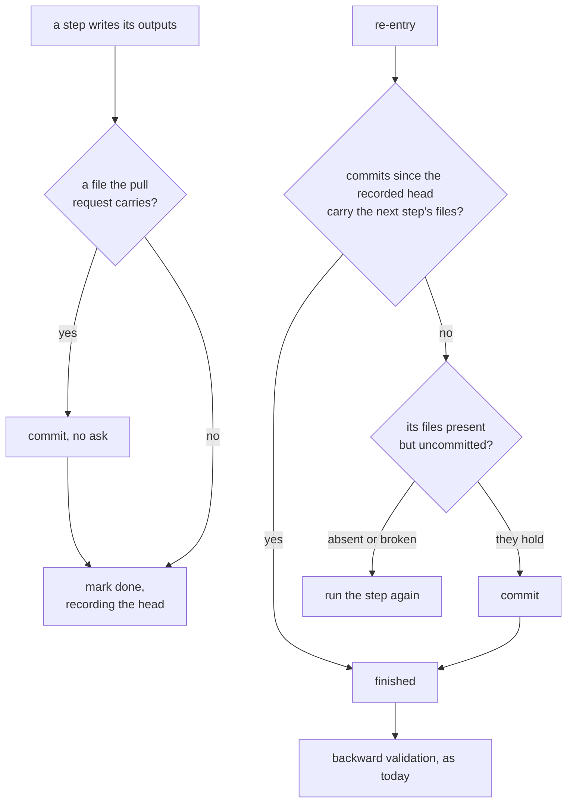
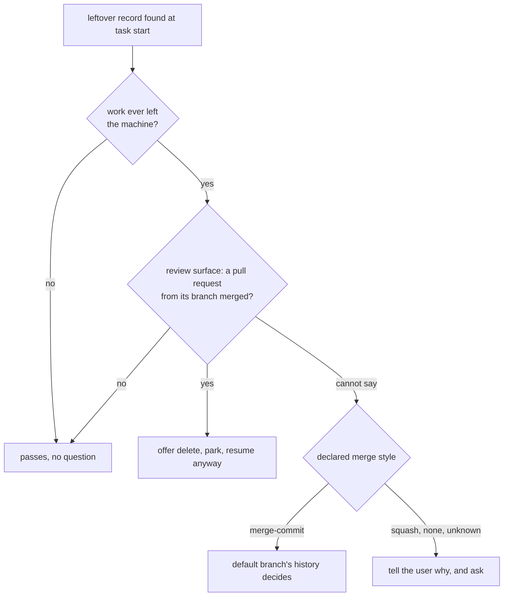

# Design: Commit each workflow step, drop the commit ask

**Ticket:** GH-180
**Date:** 2026-11-03
**Spec:** ai-docs/plans/2026-11-03-commit-each-workflow-step.spec.md

## Approach

Each task-workflow step becomes a write transaction. A step changing a file the pull request carries
writes it, makes its `step commit` on the task's branch without asking, and only then is marked done in
the local progress record; a step writing only that record writes it, then marks. The other committing
workflows keep their commit points and lose only the ask. Pushing and opening a pull request stay asked,
and the two commit guards — none on the default branch, no attribution trailer — are untouched.

Every mark also records the branch head in the record's `step_commit` field, so re-entry can tell whether
the step after the recorded one committed: commits since that head carrying its files mean it finished;
its files present but uncommitted are checked, and committed when they hold or redone when they do not;
backward validation then runs as today. A record from before this change has no such field, and what its
task left uncommitted is checked the same way.

The freeze stays one marked commit per approval, taken as an empty commit when the plan has not changed
since its last write was committed. The confirmation question then asks only to push and to confirm.

The `leftover-record check` stops reading the default branch's history: work counts as merged when a pull
request from the record's branch has merged on the review surface. Work that never left the machine passes
without a question. Only when the surface cannot answer does the project's `Merge style` matter:
under `merge-commit` the default branch's history decides, under `squash` the user is told why and asked.

## Key decisions

- **The party ending a step commits it**: the orchestrator for plan documents once the author's write is on disk, the group agent for its subtasks. Rejected: each author commits — commit rules in every agent contract.
- **The head is recorded in a progress-record field**, since the commit message is fixed by the requirements and a file's state cannot tell a revision committed after a verdict from the write before it. Rejected: counting the design's commits, which a rebase or an amendment breaks.
- **A review-fix round makes one commit, fix and correction together**; a correction after an implementation group commits alone. Rejected: a commit per beat, before the post-apply loop has accepted the fix.
- **The freeze is always its own commit**, so each approval has one marker with no special case.
- **The interview commits the approved spec standalone too**: that is the spec-only run, and moving the spec into the deferred folder needs it tracked.
- **`Merge style` is a row of the profile's version-control table**, `squash` or `merge-commit`, beside rows the method already reads; absent or unknown reads as `squash`, and the leftover check is its only reader.
- **"Never left the machine" is decided locally** — no pull request on the record, no upstream and no remote-tracking branch for its branch. It holds offline; this workflow always pushes with an upstream.
- **The prompt goes through each `settings.json`**: committing and staging named files allowed, the stage-everything spellings and committing every tracked change kept on ask, which the host evaluates before allow; a skill's tool list grants for one turn only.

## Risks

- **Two groups running at once in one tree** could commit each other's staged files: a group beside another commits naming its paths.
- **A text permission rule misses unusual spellings**: the method's ban on staging everything stays the rule.
- **A task re-entered on its open pull request** pushes a commit per step, each counted by the human-findings measure; the fix round, the routine route then, keeps one commit per round. Accepted: a rework a human asked for.
- **A rebase makes the recorded head unreachable**: re-entry checks the step's files as for an uncommitted step.
- **The freeze under squash** loses nothing: every reader of it runs while the branch is live, and the archive is read by its text.
- **The task skill and the method file sit near the size warning**: detail goes to pages loaded by link.

## Use cases

- `step commit` — holds a step's shared outputs before the mark; read by re-entry; carried by the pushes the confirmation and the closing step ask for.
- `step_commit` — written with every mark by the orchestrator or a group agent; read by re-entry, and by the leftover check under `merge-commit`.
- `Merge style` — declared per project, `squash` here and in the template; read by the leftover check when the review surface cannot answer.
- `leftover-record check` — runs when a task starts and finds a record: passes it, offers delete, park or resume, or says why it cannot tell and asks.
- `settings.json` — read by the host on each git command: committing and named staging unprompted, staging everything still prompting.

## Collisions

- None.

## Open questions

- None.
