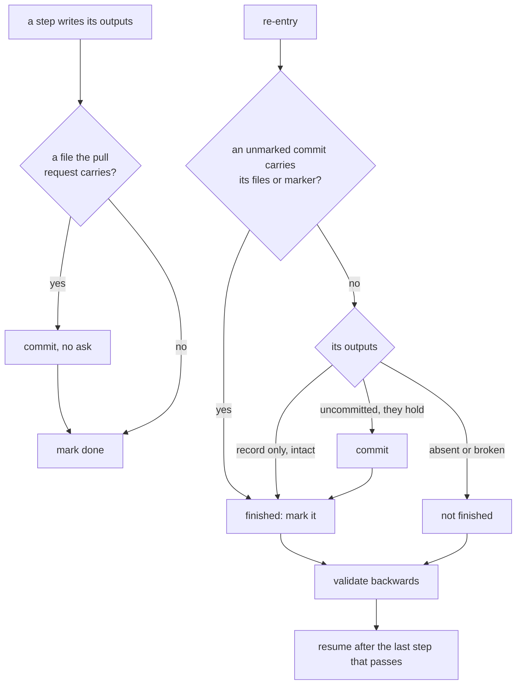
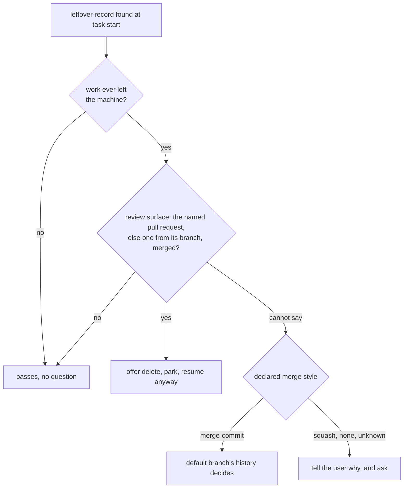

# Design: Commit each workflow step, drop the commit ask

**Ticket:** GH-180
**Date:** 2026-11-03
**Spec:** ai-docs/plans/2026-11-03-commit-each-workflow-step.spec.md

## Approach

Each task-workflow step becomes a write transaction. A step changing a file the pull request carries
writes it, makes its `step commit` on the task's branch without asking, and only then is marked done in
the local progress record; a step writing only that record writes it, then marks. The other committing
workflows keep their commit points and lose only the ask. Pushing and opening a pull request stay asked,
and the two commit guards — none on the default branch, no attribution trailer — are untouched.

Re-entry reads those commits. Before implementation only the orchestrator marks, one step at a time, and
each mark records the branch head in the record's `step_commit` field; from implementation on, where two
groups may run at once, each mark names its own commit instead, in a subtask's completion line or the
orchestrator's decisions-log entry. A commit after the recorded head, or one nothing names among those
made since implementation started from the commit the record holds as `base_commit`, closes the step
whose files it carries — the freeze by its marker. A step writing only the record has finished when its
outputs there are intact; files present but uncommitted are checked, and committed
when they hold or redone when they do not. Backward validation then checks the recorded step and each
earlier one until one whose outputs hold, and resumes right after it. A record from before this change
has no such field, and what its task left uncommitted is checked the same way.

The freeze stays one marked commit per approval, and it is never empty. Once the review's notes, if any,
are worked in and committed, the design author, the design's only writer, writes its `approval stamp` in a
pass of its own: one header line naming the approval's ordinal, the approving review round and the date. The freeze commit carries that line,
so every freeze holds a real change. No other write touches the stamp, so it never shows in the change
since a freeze. The confirmation question then asks only to push and to confirm.

The `leftover-record check` decides by the review surface, and reads the default branch's history only in
the one fallback below: work counts as merged when the pull request the record names, or, where it names
none, one from the record's branch, has merged on the review surface. Work that never left the machine passes
without a question. Only when the surface cannot answer does the project's `Merge style` matter:
under `merge-commit` the default branch's history decides, under `squash` the user is told why and asked.

## Key decisions

- **The party ending a step commits it**: the orchestrator for plan documents once the author's write is on disk, the group agent for its subtasks. Rejected: each author commits — commit rules in every agent contract.
- **A head is recorded only before implementation**, where the orchestrator alone marks, in order; the commit message is fixed by the requirements, and a file's state cannot tell a revision committed after a verdict from the write before it. Rejected: one head throughout — concurrent groups move it past each other's unmarked commits; one per group — fields repeating the completion lines.
- **A review-fix round makes one commit, fix and correction together**; a correction after an implementation group commits alone. Rejected: a commit for each of the round's acts, made before the post-apply loop — the orchestrator's check of the applied fix against the round's plan, which re-runs the fix when it fails — has accepted the fix.
- **The freeze is its own commit, carrying the approval stamp**, one marker per approval, at the cost of one more pass of the design author per approval. The stamp's ordinal is the number of approvals the progress record holds, so a stamp rewritten for the same approval is the same line, and an interrupted freeze is taken once. Rejected: an empty commit — not every version-control system accepts one; amending the last write's commit to carry the marker — it rewrites history, which not every repository allows, and an earlier round's commit would read as a freeze; writing the stamp in the pass that works the notes in — the notes and the freeze would share one commit, so the notes could not be marked done before the freeze; the round alone as the stamp's key — nothing keeps two approvals' rounds apart; one more than the design's own stamp — a rerun after an interruption would count one approval twice.
- **The interview commits the approved spec standalone too**: that is the spec-only run, and moving the spec into the deferred folder needs it tracked. Rejected: committing only inside a task run — the spec would wait uncommitted.
- **`Merge style` is a row of the profile's version-control table**, `squash` or `merge-commit`; absent or unknown reads as `squash`, and the leftover check is its only reader. Rejected: a key in the host's settings — a second home for project facts.
- **"Never left the machine" is decided locally** — no pull request on the record, no upstream and no remote-tracking branch; the workflow pushes with an upstream. It holds offline. Rejected: asking the review surface first — offline, a never-pushed record would be asked about.
- **Permissions go through each `settings.json`**: committing and staging named files allowed, the stage-everything spellings and committing every tracked change kept on ask, which the host evaluates before allow. Rejected: a skill's tool list — it grants for one turn.

## Risks

- **Two groups running at once in one tree** could commit each other's staged files: a group beside another commits naming its paths.
- **Committing every tracked change still prompts**, where committing should not: staging every change at once still needs consent, and that form does it. A stage-everything or commit-everything spelling the ask list does not name runs with no prompt. That residual is forced: committing and staging named files must raise none, so the allow is a pattern, and the host matches a command's text against a finite list of asks — the double-star staging form cannot be listed at all, a star in a rule matching any text. The method's written ban still covers the staging forms; nothing written covers the commit forms.
- **A record whose freeze was pushed is no longer passed locally**, as a record before implementation is today: under squash, with the review surface unreachable, the user is told why and asked, as the requirement for a review surface that cannot say demands.
- **A record naming an open pull request is resumed even when an earlier pull request from its branch merged.** The requirements' decision on recognising merged work tests the pull request the record names before any from its branch; their criterion on a merged record holds whether or not the record names one. The two part only here, and the design follows the decision, the more specific of the two, so work reopened under a new pull request keeps its record.
- **A task re-entered on its open pull request** pushes a commit per step, each counted by the human-findings measure, which counts each ordinary commit pushed after a pull request opened as one finding a human raised; the fix round, the routine route then, keeps one commit per round. Accepted: a rework a human asked for.
- **A rebase rewrites the commits re-entry reads**: it then checks the step's files as for an uncommitted step.
- **The freeze under squash** loses nothing: every reader of it runs while the branch is live, and the archive is read by its text.
- **Until the next approval the design keeps the last approval's stamp**, through a redesign after a refused confirmation or an amendment: the change since that freeze, which every reader computes, shows what moved.
- **The task skill and the method file sit near the size warning**: detail goes to pages loaded by link.

## Use cases

- `step commit` — holds a step's shared outputs before its mark; read by re-entry; carried by the pushes the confirmation and the closing step ask for.
- `step_commit` — written by the orchestrator with each mark before implementation, then replaced by `base_commit`, the same commit; read by re-entry, and by the leftover check under `merge-commit`.
- `approval stamp` — written by the design author once per approval; carried by the freeze commit; read by the human at the confirmation and on the review surface; read by re-entry, which commits a stamp naming the recorded approval, found uncommitted, as that approval's freeze.
- `Merge style` — declared per project, `squash` here and in the template; read by the leftover check when the review surface cannot answer.
- `leftover-record check` — runs when a task starts and finds a record: passes it, offers delete, park or resume, or says why it cannot tell and asks.
- `settings.json` — read by the host on each git command: committing and named staging unprompted, staging everything still prompting.

## Collisions

- `step_commit` repeats, at the confirmation, the freeze its answer names, until `base_commit` replaces it. From implementation on the record's last-passed-gate field can name a commit a completion line or decisions-log entry names; it records what a check last ran over, and re-entry does not read it.
- The `approval stamp` records in the design the approval the freeze marker records in history; the marker stays what a freeze is found by.

## Open questions

- None.
