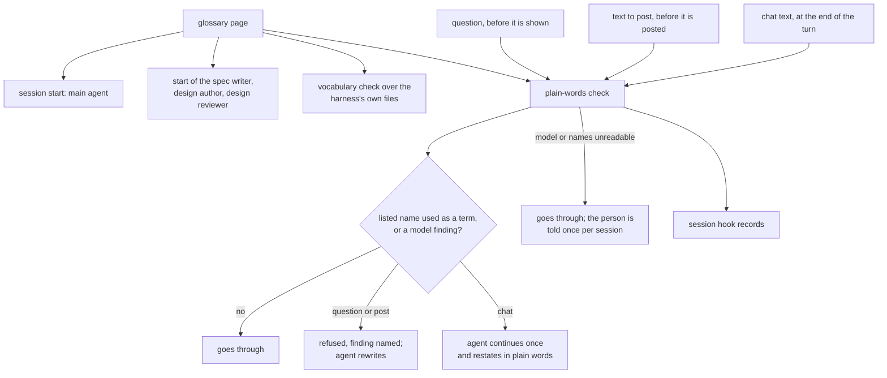

# Design: One vocabulary for the harness

**Ticket:** GH-166
**Date:** 2026-11-15
**Spec:** ai-docs/plans/2026-11-15-harness-vocabulary-glossary.spec.md
**Approved:** 1st approval, design review round 2, 2026-11-15

## Approach

The harness gets one `glossary page`, shipped with the method pages. Each concept has one entry: the name
the harness uses for it, the other names it has been called, one sentence on what it is, one on what it
does, written for someone who has never opened the harness's files, and the page and section that define
it — or, for a knowledge-base concept, that it is planned. Names whose concept is gone sit in a closing
table with what they used to name. The page opens with the rule for anything written to a person: the
description carries the meaning, in the person's language; the name appears at most as an untranslated
aside; no name is translated into a term or invented; a concept with no entry is described by what it
does, and a proposed entry goes into the pull request's description. The names are written in a fixed
form, so one shared `glossary name reader` takes them from the page for every check below; there is no
second list.

Five pieces of work surround the page.

1. **It is in context from the start, through the `glossary loading hooks`.** Beside the session-start
   hook that tells the agent to read the method page, the glossary itself enters the main agent's
   context at the start, after the conversation is cleared, and again after the context is compacted. A
   resumed or forked session does not load it again: it rebuilds its conversation from the stored
   messages, which hold the pieces loaded earlier (claimed from how this project's session logs store a
   hook's added context; not observed, since no session here was ever resumed). The host cuts any one
   hook message over its size cap — a threshold of 10,000 characters the host's hook documentation
   states — down to a file path and a short preview: measured here, a 15,025-character message arrived
   as a 2,486-character notice naming the file that holds it (a throwaway session, Claude Code 2.1.304,
   2026-11-16). So the page goes in several messages split between entries, each holding at most 9,500
   bytes of the page, a threshold the loading hook sets (read from its script), plus a line naming its
   part, because the pieces arrive in no fixed order. Five are registered, by arithmetic 47,500 bytes in
   all, enough for a page at the instruction size cap the method hands down, 40,000 characters; a page
   past them makes the last piece name the page rather than end silently, and the shipped page arrived as
   four in that session. Three agents get it too, because their
   writing reaches the owner as written or holds the rule there: the spec writer, the design author and
   the design reviewer. The interview and task skills start these three as general-purpose agents whose
   brief names the agent's page, so the agent's type alone does not pick them out; a hook on the
   agent-starting tool appends the page to the brief of a start whose type or brief names one of the
   three, unless the brief already carries it.
2. **One sweep renames.** Every other name and retired name on the covered surfaces becomes the canonical
   name of what it names at that place; a listed name that names several things is replaced, at each
   place, by the name of the thing it names there, as the table of such names below says. A word with
   several senses keeps one, chosen below; the senses that were ordinary English — a branch of a script,
   a guard switched on, whitespace collapsed, a starting measurement — are rewritten in plain words and
   get no entry, as are the names of single parts of one check, one round or one agent's run. A page,
   agent, script, flag or per-task file whose own name carries a listed name is renamed and every
   reference moves.
3. **The `vocabulary check`** joins this repository's check list. It reads the listed names and every
   covered file and fails naming the file, the line and the name, with no exemption for quoting: the
   glossary page alone may carry them. In a script it skips the names the script gives its own variables
   and functions, and a line carrying an `internals mark` — a comment holding `vocabulary-internal:` and
   why the old word must stay: text an earlier file carries and the script still reads, or a test's
   planted copy of it. A mark alone on its line covers the lines below it up to the next blank line, a
   mark giving no reason is itself a finding, and a mark in a page of prose does nothing. In every
   covered file it skips the bracketed id a script's comment carries, so that a document can name that
   function or variable in the script's own spelling. It also refuses a
   glossary whose names collide. It reports which surfaces and how many files it read. A page it cannot
   read, one that yields no names, or a covered file it cannot read is a could-not-run, never a pass.
4. **The `plain-words check`** runs in every project using the harness, at the three moments the host
   allows: a question, before the question tool shows it; a text to post, before a posting command runs —
   which commands post, and which of their flags carry the text or name its file, is the project's
   `Posting commands row` in its profile; and the chat text of the main agent's turn, when the turn
   ends. Each text is read twice side by side: the listed names are matched outside quotation and code marks, and a model reads it
   with the glossary for three breaches — a name translated word for word and used as a term, a name
   invented for a concept, a harness name carrying the meaning with no plain description. A refused
   question or post names what was found, and the agent rewrites and retries. After each refusal made by
   the model's reading alone, only the next question or posted text in that turn is exempt from the
   model's reading; a later one is read and can be refused again. A listed name used as a term is refused
   every time. Chat text, already shown, makes the agent continue once and restate the
   affected sentences, asking nothing; the restatement is not read again. When the model or the names
   cannot be read, the text goes through and the person is told once per session that what the agent
   writes to them is not being checked. That notice reaches the person as a warning the host shows
   them straight from the hook's answer, asking nothing of them. Every reading leaves a
   `plain-words record` among the session's hook records.
5. **The knowledge-base planning documents** kept outside the repository are rewritten with the canonical
   names when the task closes.

### The glossary, entry by entry

What the owner approves before the sweep. Each row is one entry; "Other names" are the names the sweep
replaces and both checks refuse, with their plural and verb forms. A dash means none. "What it is" is a
gloss for this approval and may name another entry; the glossary page itself gives each entry two
sentences, what it is and what it does, that name no file, script, command, section or other entry, so a
person can follow them alone. Of the things the spec records as named by coinages in conversation, one
setup among those compared in a measurement is the measurement setup; the version of the files the next
review compares against is what the checklist ledger fingerprints; the helper agent that wrote down which
statements must change together is the design author.

#### Workflow and agents

| Canonical name | What it is | Other names |
|---|---|---|
| main agent | the agent the person talks to, which starts every other agent | "main thread" |
| orchestrator | the main agent while it runs a workflow: it starts the other agents, commits, and keeps the progress file | — |
| subagent | an agent started by another for one job, in a fresh context, which ends by handing back a report | — |
| skill | a named workflow started by a slash command, by the person or by an agent | — |
| spec workflow | the ordered steps a task runs today, from interview to pull request, with a spec of its own: interview, spec, design, design review, implementation, verification, self-review | "spec flow", "task workflow" |
| interview | the questions put to the owner, a round at a time, before a spec is written | — |
| spec writer | the agent drafting the spec from the interview's answers | — |
| design author | the agent writing a task's design, its working plan and its record of declared links | "design subagent" |
| fix scout | the agent writing a review-fix round's fix plan in a fresh context | — |
| fix-apply agent | the agent applying the fix rows of a plan the fix-plan check passed, and nothing else | — |
| finding | one problem a review or a check reports, with its severity: blocker, major or minor | — |
| session inspection | reading a finished session for loops, repeated checks and review rounds that burned their cap: a script counts, an agent judges | — |

#### Plans

| Canonical name | What it is | Other names |
|---|---|---|
| spec | a task's requirements: what the system must do, seen from outside, with numbered criteria | — |
| design | the document stating the approach chosen for a task, which the owner approves | "design doc" |
| plan | a task's spec and design taken together | "plan pair", "spec/design pair" |
| progress file | the task's working notes on the owner's machine, never committed: where it stands, its decisions, its review findings | "progress record", "working record" |
| plan freeze | the commit made when design review approves; every later change to the plan is measured from it | — |
| spec amendment | a change to the requirements the owner approves while the task runs | — |
| design amendment | a rewrite of the approach while the task runs, reviewed again and frozen again | — |
| earlier-shape design | a design written before the working plan moved to the progress file; it carries its own decomposition table, and the length cap does not bind it; every other design is in the new shape | — |
| length cap | the soft limit the owner set on a design's length | — |
| working plan | the design author's table of subtasks and their groups, kept in the progress file, which the implementation runs from | — |
| in-place correction | rewriting an item of a frozen design so it states what shipped, the approach unchanged | "correction pass", "correction beat" |
| working in the review notes | putting design review's notes into the design or the working plan before the freeze | "fold-in", "folded in", "unfolded note" |
| cut-down spec | an archived spec that a since-removed last step cut down to three sections; the checks still recognise it, and the commit that made it, and skip both | "folded spec", "collapsed spec" |
| deliberate absence | what a spec records the task leaves out on purpose: out of scope, deferred, key decisions | — |
| plan archive | the folder of finished tasks' specs and designs, and the listing of it the whole-repository review reads | — |

#### Checking a plan

| Canonical name | What it is | Other names |
|---|---|---|
| convergence check | the script reading a spec and a design for six kinds of defect | "deterministic half" |
| completeness | the kind: every criterion is delivered by some step, every object has a use | — |
| arithmetic | the kind: a sum or count the plan states actually holds | — |
| provenance | the kind: every number says where it came from | — |
| reference | the kind: no reference to a line or position that goes stale | — |
| pairing | the kind: an id the plan cites matches the id beside the code, both ways | — |
| isolation | the kind: one fact is not repeated word for word in several places | — |
| holding class | a kind whose finding stops the design being handed back or approved | — |
| report-only | a check, or one kind of finding, that is shown and stops nothing | "advisory mode", "shadow mode" |
| contradiction reader | the AI reviewer reading a spec and a design for statements contradicting each other or existing files | "plan-convergence reader", "convergence reader", "whole-pair reader", "judgement half", "judgement class" |
| record of accepted findings | the committed list of convergence findings a plan accepts as they stand | "record of excused findings", "excuse record", "excused convergence findings", "excuse route" |
| accepted finding | one row of that record: a finding kept visible with the reason it does no harm here | "excused finding", "waived finding" |
| accepting act | the one way a row enters that record: the convergence check run with the finding and the grounds, showing the finding before it writes the row | "grant act" |
| record of declared links | the committed list of statement pairs in a plan that must change together, written by the design author | "link record" |
| declared link | one row of it: two quoted statements and why they move together | — |
| link check | the script telling, for each declared link, whether both statements still stand | — |
| record of accounted positions | a project's recorded list of line-number references that predate their ban; the reference kind reports only new ones | "baseline record", "positional baseline" |
| plan invariants | the fixed rules on what a spec and a design are and must contain, and the pages stating them | — |
| base principle | one numbered rule of the plan invariants | — |
| required element | a section a spec or a design must carry | — |
| protected page | a page that defines or enforces a required element | — |
| near miss | a page close to the protected set and deliberately outside it | — |
| plan-invariants guard | the hook asking before an edit changes a protected page, in a session improving the harness | "edit-time refusal" |
| learning mode | the state of a session that ran one of the workflows turning the Learning Log into rules | — |

#### Reviews

| Canonical name | What it is | Other names |
|---|---|---|
| design review | the sceptical review of a design before any code, made by an agent of its own | "plan review" |
| design review verdict | GO approves, ITERATE sends back for rework, STOP rejects the approach | — |
| self-review | the review of the finished change against the spec, the design and the rules | — |
| self-review verdict | APPROVE: ready to push; REJECT: problems remain open | — |
| whole-repository review | the review of a whole branch's code rather than one change | "whole-branch review", "codebase review", "whole-codebase review" |
| checklist ledger | the table ending each self-review round, fingerprinting each file and rule reviewed, so the next round reviews only what changed | "review ledger" |
| review-fix round | after a REJECT: take the round baseline, write the fix plan, check it, apply it, check the applied change against the plan, correct the design where a row says so, review again | "review-and-fix round", "scouted fix", "scouted-plan", "scouted flow" |
| round baseline | the snapshot of the files when a review-fix round starts; the applied fixes are measured against it | — |
| fix plan | one row per open finding: what to change, where, and how much | — |
| fix-plan check | the script deciding whether a fix plan is applied, sent back or routed to an amendment, by a fixed set of tests each printing its own line | — |
| amendment trigger | two tests on a finding: Arm A, closing it would leave a spec or design sentence untrue; Arm B, the fix edits the spec or the design | — |
| correction row | a fix-plan row saying the shipped code departs from the design without breaking the approach | — |
| post-apply micro-loop | one question whether the applied change matches the plan, with a bounded number of re-fixes | — |
| human finding | a review comment, or a fix pushed after a pull request opened, counted to see what review missed | — |
| post-push fix round | a round fixing failing checks or reviewer comments once the pull request is open, in whichever workflow runs it | "post-push round", "post-push fix loop" |

#### Keeping files in step

| Canonical name | What it is | Other names |
|---|---|---|
| Propagation Rule | editing one instruction file means updating, in the same pull request, the files that describe the same thing | — |
| sync group | one named set of files the Propagation Rule keeps in step | — |
| propagation reminder | the hook naming a file's sync group when the agent edits it | — |
| path pattern | one file-path pattern the propagation reminder matches | "propagation arm", "reminder arm", "pre-fix arm" |

#### Learning Log

| Canonical name | What it is | Other names |
|---|---|---|
| Learning Log | the record of each instruction the agent broke, and the rule drawn from it | "corrections log", "corrections-log", "instruction-violation log", "learning record" |
| Learning Log archive | the file holding every entry once its branch merged | "learnings archive" |
| Learning Log fold | moving merged branches' entry files into the archive unchanged, then deleting them | — |
| promotion candidate | a lesson about the method itself, stripped of project names, kept for a sweep across projects | — |
| redaction gate | the check refusing a promotion candidate that names one project's material | — |

#### Checks and hooks

| Canonical name | What it is | Other names |
|---|---|---|
| hook | a script the host runs at a fixed moment — session start, before or after a tool call, a turn's end — through which the harness reminds, records or refuses | — |
| gate | a check whose result decides whether work goes on | — |
| could-not-run | a check's result when it measured nothing; never a pass | — |
| positive control | a planted fault shown to be caught by the check meant to catch it | — |
| check list | this repository's checks, run together | "gate list" |
| check-list member | one named check in the check list | — |
| check runner | the script running the check list, one verdict per member | "gate runner" |
| structural check | a check of the harness's own files, as against a delivery gate | — |
| verdict line | the first line a check prints: clean, findings or could-not-run, with how much it examined, followed by a roster of what it read | — |
| spec-criteria check | the script refusing a spec criterion that names how it is tested, and a review taking leave to skip a finding from anything but a finished spec | — |
| plan-invariants check | the script checking that the base principles, the required elements and the plan-invariants guard agree with the pages stating them | — |
| touched-scope run | inside a loop, only the checks the changed files select | — |
| full run | the whole check list, once, after review approves | — |
| delivery gate | a check that what the plugin ships reaches a project: it installs, it upgrades, its version moved | — |
| result masking | hiding a gate's failure behind another command's success; a hook refuses its common shapes | "gate-pipe-guard" |
| gate record | the hook recording each gate run, with the state of the files it ran on | — |
| tree digest | a fingerprint of the files as version control sees them | — |
| fixture | a recorded real input a check replays, with the results it must reproduce, never refreshed casually | "frozen fixture" |
| loop ledger | the per-session file where the harness's hooks record each tool call and what they noticed | — |
| loop detector | the hooks flagging a repeated call, or one kind of call repeated within a turn | — |
| measurement setup | one of the setups a measurement compares | "measurement arm" |
| payload sibling | a file in another language that a shell script loads from its own folder | — |

#### The harness and a project

| Canonical name | What it is | Other names |
|---|---|---|
| harness | the plugin itself: the method, skills, agents, hooks and checks it ships to every project | — |
| consuming project | a project using the harness | — |
| scaffolding | the starting files the harness writes into a project it is set up in, never overwriting one | — |
| method | the half of the harness that holds in every project | — |
| profile | a project's own half: its commands, language, permissions and facts, among them which commands post to the review surface or the tracker | — |
| project registry | the list of projects set up with the harness, kept in the user's home folder | — |
| deployed configuration | files holding environment-specific settings, read only after asking | — |
| instruction file | a file of rules the agents read; those loaded whole at every agent start are capped in size | — |
| instruction size cap | the method's limit on the size of a file loaded whole at agent start, with an early warning below it | — |
| AXIOM | a rule the method marks as binding with no exception | — |
| defect report | a report a project files back to the harness about a defect in it | — |

#### Knowledge base (planned, not yet part of the harness)

| Canonical name | What it is | Other names |
|---|---|---|
| knowledge base | a project's store of its current requirements, constraints and deliberate non-goals, one file per area | — |
| knowledge-base workflow | the planned way of running a task, which writes its requirements into the knowledge base rather than into a spec of its own | "card flow" |
| task document | the short committed document holding what a task does not leave in the knowledge base | "task card" |
| interview summary | what the owner approves after the interview, before the design | "interview card" |
| knowledge-base section | the section the harness writes into a pull request's description | "merge card", "PR card" |
| summary command | the command building the interview summary and the knowledge-base section | — |
| interview approval commit | the commit recording that the owner approved the interview summary | "interview freeze" |
| required CI check | the check a pull request must pass before it can merge | "merge gate" |
| new-conflicts-only blocking | a promoted check refusing only the conflicts a branch itself brings | "ratchet mode" |
| list of removed statements | the record of statements taken out of the knowledge base, with their reasons | "removed registry" |
| defaults list | the list of defaults the owner confirms in one answer | "the one block" |

#### This vocabulary

| Canonical name | What it is | Other names |
|---|---|---|
| glossary | the page holding one entry per harness concept, opening with the rule for text for a person; hooks put it into the agents' context, and both checks read its names through one shared reader | — |
| listed name | an other name or a retired name the glossary lists, which the checks refuse | — |
| vocabulary check | the check failing when a listed name appears in the harness's own files | — |
| plain-words check | the hooks reading what the agent writes to a person for listed names and coined words, recording each reading with the session's hook records | — |
| internals mark | the comment, `vocabulary-internal:` and why, marking a line of a script, or the lines below it, that must keep an old word | — |
| model-call marker | the setting a harness hook puts in the environment of a model it calls, so the hooks that load the glossary or read text for a person do nothing inside that call | — |

#### Retired names

| Retired name | What it named |
|---|---|
| closing fold | the removed last step of a task, which applied the logged design changes to the design and cut the spec down |
| redline fold | the same step |
| redline log | the log of design changes that step applied, removed with it |
| correction log | the same log |
| redline | that log, and anything named after it |

### Terms printed by hooks and scripts

Every harness term a hook or a script prints for a person was listed over the hooks and scripts on this
branch on 2026-11-15. A term naming a concept of its own has an entry above. A term naming a part of a
concept — a field, a state, a count, one test of a check, a value a program reads back — is covered by
that concept's entry:

| Entry | The printed terms it covers |
|---|---|
| could-not-run | "cannot run" in every spelling, "could-not-compute", "unavailable", and the link check's "skipped", which exits as a could-not-run |
| verdict line | "verdict", "clean", "findings", "dirty", the roster and its states (examined-clean, examined-with-findings, not-examined), "unaccounted", "named exclusion", "surface" as a set of files a check reads |
| finding | "open finding", the severities blocker, major and minor, the finding codes a check prints |
| fix plan | "disposition" and its values fix, object, resolved, amendment and correction; "plan row"; the file-and-line anchor a row quotes; the declared and allowed number of changed lines |
| fix-plan check | its decisions PASS, REFUSE, ESCALATE, ROUTE-SPEC, ROUTE-DESIGN, OK and FINDING; its numbered tests and their names; "size over threshold"; "verification named" |
| post-apply micro-loop | its answers MATCH and DIVERGE, its iterations and the tool calls it cost |
| amendment trigger | the Arm A cell and the reasons naming it |
| checklist ledger | a row's digest, the plan digest, carried and swept rows, triggers, scope, the objections row, "seal", "whole list reset", the ledger's base, "checklist item" |
| convergence check | "class" for its kinds, a finding's spot and subject, the counts on its verdict line, "built path", the criterion-delivery and use-case tests, the ids that code comments carry, which the pairing kind matches against the plan's |
| earlier-shape design | "decomposition", "decomposition row", "new shape" |
| plan-invariants check | its legs and their finding labels, "pinned sentence", "one-clause reason", the three routes deriving the required elements, the corpus it reads, an element that arrived or departed |
| plan-invariants guard | its coverage, registration and matcher, an unguarded route, a surplus member, an element-defining page, the protected-page and near-miss tables |
| path pattern | the propagation-pattern check's derived classes, representatives, controls, regression probes, earlier patterns, exclusions and catch-all row |
| link check | the states silent, moved, re-confirm and ambiguous, and a link's two ends |
| check runner | member verdicts, an exempt script, the inventory comparing its members with the agent rules file, a runner member |
| check-list member | each member's name and its own findings: a stack name, a foreign identifier, a whole-loaded file, the warning band, the update surface and upgrade verb, a plugin path, a project-data path, the scaffolded copy |
| delivery gate | install smoke, release check, upgrade smoke, shipped content, the version bump, the install cache |
| spec-criteria check | its two verbs and their findings: a criterion spelling an instrument, a review conferring suppression |
| redaction gate | its rule and report modes, the deny vocabulary, a project identifier, a ticket key, a candidate's required sections, the ambiguity warning |
| defect report | its required sections, the file of filed reports, a report's hash |
| project registry | the registry, its shared and local scope |
| profile | the profile file, a placeholder for a command and an unfilled one, the ticket key, the diagram form, the version-bump paths line |
| spec | the ticket line in its header, a criterion |
| session inspection | the session signatures, step ordering, attribution, the per-agent count, spend per turn, the loop detector's figures it reports |
| loop detector | its tiers and stages, its signals (coarse repeat, error retry, fan-out, loop), the judging stage's answers circling and progress, outcomes, verdicts, turn markers, fingerprints and the command shape it bins a call into |
| orchestrator | "owning subagent" |
| subagent | "hand-back", "parent", "sibling", "subagent contract" |
| hook | the name each harness hook prints in brackets at the head of its messages and in the line the host shows while it runs, and what a hook with no entry of its own checks: an empty diff range, a shell file's syntax, staging the Learning Log with a commit, a new entry's placement in the log |
| gate record | a repeat and a contradiction of an earlier run, the files a gate ran on |
| deployed configuration | the permission to ask before reading, the honour system, the profile's line naming the files |
| Propagation Rule | the sweep a pull request runs before it closes, the directory the patterns are matched from |
| learning mode | "learning pass" |
| required element | "required section", the record of required elements |
| harness | "harness install", the harness's block in a project's ignore file |
| consuming project | "consumer", "scaffolded project" |
| Learning Log | its contract, an entry's fields (its kind, whether it was escalated), the boundary rules, an entry added in the wrong place, the composition class, escalation |
| result masking | "no-masking rule" |
| plan | "plan document", the plan-documents surface, the name a plan's files share, the "plan" verb of a command |
| method | "method file", "method rules" |

A label coined for one script's own figure that no entry covers is rewritten in plain words in the
message: the backlog measurement's "planning burst", "drip share", "cadence" and "deferral", and the
propagation-pattern check's "carve-in" and "independent witness". "Payload" for the installed plugin
becomes "installed copy", since the payload sibling keeps the word; "cap" for the instruction size cap is
said in full, since the length cap is another limit; "STOP" for stopping to ask the person becomes those
words, since STOP is a design review verdict; the human-finding count's "fold", which counts commits the
removed last step made, says that. A generic word in a sense its compound does not have is said in full or
in plain words: "gate" for a permission prompt ("asks first"), "verdict line" for a row the loop detector
writes, "ledger" alone, "member" for a protected page. A listed name a script prints is rewritten like any
other.

### Listed names that name several things

Every listed name was looked up in every covered file on this branch on 2026-11-15, in its plural and
verb forms and with a space or a hyphen between its words, and each line it is on was read for what it
names there. The names below name more than one thing; each stays an other name of the entry it names
most, and where it names something else the sweep writes that thing's own name:

| Listed name | Kept by | Also names, and what the sweep writes there |
|---|---|---|
| "correction pass" | in-place correction | a round fixing a pull request already open, in the method page's rule on the end of an iteration and the workflow page's section on it: post-push fix round. The improvement agent's pass over the Learning Log's correction entries, in its own steps, the agent auditing the log's entries and the page giving an entry's format: "the pass over correction entries" |
| "working record" | progress file | in the spec-amendment procedure, the record of whichever workflow is running, which is the progress file or a bug fix's trace: said in those words |
| "scouted fix" | review-fix round | "scouted fix plan" where it names the plan a round's fix scout writes, in the workflow page's table of the skills the amendment trigger fires in: fix plan |

Every use of "excuse route" names the record of accepted findings together with how the convergence check
reads and writes it, never the accepting act alone, so it is listed under the record. "Task workflow" names the spec workflow wherever it occurs; it is listed under
that entry rather than made its canonical name, because the planned knowledge-base workflow is a way of
running a task too, so the name would come to mislead. The fix round on an open pull request, which
"correction pass" also names, has its own entry, post-push fix round; "follow-up round", which names it
too, is ordinary English and left to the sweep. Every other listed name names one thing wherever it
occurs.

### Names this task adds

Every name this task puts into a covered file has an entry above — listed name, vocabulary check,
plain-words check, internals mark, model-call marker — or is covered by the entry named beside it, so the
owner sees every canonical name at this approval:

| Entry | The new names it covers |
|---|---|
| glossary | the glossary page; the rule for text for a person and the terms it uses: canonical name, other name, retired name, plain description, mention, text for a person; the glossary name reader; the glossary loading hooks; a proposed glossary entry |
| plain-words check | the plain-words record; the kinds of finding it reports; the notice that it cannot read; the setting naming its model, and its time limit; the measurement of its model reading against planted texts |
| vocabulary check | its check-list member and its numbered place in the check list |
| profile | the Posting commands row |
| sync group | the Vocabulary sync group |
| design review | the design reviewer, the agent making it |
| accepting act | the convergence check's flag for accepting a finding |
| accepted finding | the word marking one on a finding line |

A renamed page, script, agent or per-task file takes the name of the entry its row below gives.

### What changes its name

The list below comes from matching every tracked file name, check-list member, flag and agent name
against every listed name and against the senses a several-sense word loses. Archived plans, Learning Log
entries and fixtures carrying a listed name in their file names also match, and keep their names as
history.

| Today | Becomes | Why |
|---|---|---|
| the Learning Log's field page, named after "corrections log" | the Learning Log page | an other name of the Learning Log |
| the review-fix round's procedure page, named after "scouted fix round" | named after the review-fix round | an other name of the review-fix round |
| the checklist ledger's script and its test, named after "review ledger", with the program name every message of the script starts with | named after the checklist ledger | an other name of the checklist ledger |
| the contradiction reader's agent page and agent name, which with "reader" make "plan-convergence reader" and which name the convergence check as well | named after the contradiction reader | an other name, and one naming two things |
| the spec-criteria check and its test, named after "redline" | the spec-criteria check | a retired name |
| the propagation reminder's check, its test and its check-list member, named after "arms" | named after path patterns | a sense "arm" loses |
| the convergence check's flag for accepting a finding, named after "excuse" | named after accepting | the harness sense of "excuse", an other name of an accepted finding |
| the per-task record of accepted findings, named after "excuse" | named after accepting; a record under the old name is still read | the same |
| the result-masking hook's second name, in the table of hooks on the page listing every name the harness defines | its one name | two names for one hook |
| headings and sync-group names carrying a listed name | the canonical name; every link to them moves | same |
| the design author's agent page and agent name, "design", which is also the document's canonical name | kept | "design" is no listed name, so neither check reads it, and prose names the agent the design author; renaming the page would change two rows of the record of accounted positions beyond their file path — the plan-invariants guard's test quotes the page's path in two line-range reads that record accounts for — and the spec lets a row of that record change only its file path, when the file holding the position is renamed |

The design review's and the self-review's agents keep their names: an agent named after the review it
makes is covered by that review's entry.

## Key decisions

- **A word with several senses keeps the one it names most, where scripts read that sense in files.**
  *Fold* keeps the Learning Log fold: its test, its sync group and its contract carry it. *Arm* keeps Arm A
  and Arm B, the amendment trigger's two tests: Arm A is a column of every fix plan, which the fix-plan
  check reads, and Arm B is named beside it in the trigger's prose. *Baseline* keeps
  the round baseline, the fix-plan check's own step. *Freeze* keeps the plan freeze, including the plan's
  text as it stood then. *Card* is on no covered surface today, so all its senses go to knowledge-base
  entries. Rejected: retiring every such word — renames what scripts read in files written before the
  task, which changes what they do.
- **A listed name that names several things is kept by one entry**, the one it names most; wherever it
  names something else the sweep writes that thing's own entry's name, or plain words where it has none,
  and never the keeping entry's name. Rejected: replacing every use with the keeping entry's name — the
  sentences about the other things turn false.
- **Ordinary English gets plain words, not entries**, and a generic word that heads several names —
  record, ledger, archive, member — names nothing alone; the compound is the name. A spelling variant of a
  canonical name, such as "cannot run" for could-not-run, is that name. Rejected: entries for such uses —
  a page of non-concepts.
- **The refusal lists the qualified forms of an ordinary word**, never the bare word: "folded spec", not
  "folded"; "excused finding", not "excuse"; "merge card", not "card". The sweep and review hold the bare
  word. Rejected: listing it bare — refuses prose, and the plain-words check would refuse a question
  saying that one option beats another.
- **A name for one part is not an other name of the whole.** The fix-plan check's single tests ("size
  arm", "routing arm" and the rest) and the review-fix round's numbered steps ("beat" with its number) are
  rewritten as what each tests or does — "the size test", "the step that applies the plan". A step that is
  a concept of its own has its entry: round baseline, fix plan, fix-plan check, fix-apply agent, post-apply
  micro-loop, in-place correction. Rejected: listing a part's name under the whole — the sweep would turn
  "there is no size test" into "there is no fix-plan check".
- **One source.** Both checks read the names from the glossary through one shared reader. Rejected: a
  separate list file — two lists drift.
- **Quoting is a mention only in text for a person.** In the harness's files every appearance counts,
  because the glossary is where an old name lives on. Rejected: exempting quoted names in files — the
  sweep's leftovers would hide behind backticks.
- **Script words are skipped by kind, not by file**: in a script, the names it gives its own variables
  and functions and the lines under the internals mark; in every covered file, the bracketed ids a
  script's comments carry, which documents cite in the script's own spelling. Rejected: a per-file allowance — it would hide a printed message
  in the same file; reading only comments and strings — misses unquoted shell text.
- **Entries are short.** The page holds its 125 entries in 30,175 characters, 241 an entry on average,
  and with the rule, the section on words a script must keep, the five retired names and the headings
  comes to 33,949 characters (each figure measured by a character count of the page on this branch,
  2026-11-16), below the 35,000-character early warning (a threshold the method hands down), with room
  for about 4 more entries ((35,000 − 33,949) / 241). Rejected: the
  spec's estimate of about 410 characters an entry — the page then holds about 85 entries, fewer than the
  required list.
- **Posting commands are declared in the project's profile**, as the deployed-configuration patterns are,
  because the method names no host or tool. A profile with no such row is a could-not-run for posts, told
  once per session. Rejected: matching a known tool — puts a host's name in the method.
- **The glossary reaches three agents by their brief**, appended at the start, and no others. Rejected:
  every agent at its start — pays the page on agents that write only for agents; by agent type alone —
  the interview and task skills start these three as general-purpose agents.
- **The model is called through the host's command-line client**, as the turn-end loop detector's optional
  judging stage already does, with a small model by default, a setting to change it, and a time limit the
  hook sets. Both calls — this check's and that judging stage's — carry the `model-call marker` in their
  environment, and the glossary loading hooks and the plain-words check do nothing in a session carrying
  it. Rejected: no
  marker — the child session would load the glossary and run the turn-end check on the model's own
  answer, calling the model again; a marker that silences every harness hook — changes what the existing
  hooks do in that child session.
- **The chat text read is the whole turn's**: the transcript's assistant text since the person's last
  message, plus the final message the turn-end event carries, which the host says the transcript may not
  yet hold. Rejected: the final message alone — a coined name earlier in the turn is missed.
- **The hook records hold every reading**, finding or none, as a new record class, and the check's own row
  at each turn end bounds a turn. Rejected: a file of its own — a second session record; findings only —
  leaves nothing to count a rate against.
- **The record of accepted findings is read under both names and written under the new one**, so a task in
  progress keeps what it accepted; the `record of accepted findings` under its new name is the one file
  this task renames that a project already holds. A row names the finding it accepts by the words the
  finding line prints, and one such line carries a listed name: the pairing kind names its place as "the
  plan pair". The line prints the new words, and a row recorded with the old ones still matches it.
  Rejected: migrating the old file or its rows — changes a file nobody asked to change.

## Risks

- **Three files loaded whole sit close to the early warning**: the method page, the task skill and this
  repository's project context page, 621, 954 and 1,200 characters below it (measured by a character
  count of each file on this branch, 2026-11-16). Mitigation: in those files a canonical name is no longer
  than what it replaces where a shorter one exists; otherwise explanation moves to a page reached by link.
- **The glossary itself sits near the warning**, 1,051 characters below it by the measurement above,
  leaving little room for later entries. Mitigation: a later entry for one part of a concept already
  present merges into that entry.
- **These host behaviours are documented by the host and not yet observed here (verify)**: a brief
  rewritten at an agent's start reaching the agent, a denied question never reaching the person, the
  final message the turn-end event carries, the flag the host sets on a turn end that follows a hook's own
  continuation, and a warning in a hook's answer shown to the person without asking anything. Nor is a
  resumed session still holding the glossary pieces loaded at its start observed. Before this
  task no hook in this repository relied on any of them (a search of its hooks for the host's fields
  behind them, on this branch, 2026-11-15). The brief rewrite was tried and not observed: a throwaway
  session stops at the login before any agent starts. The hook appending the page to a brief is built as
  the host documents it; if the host ignores the rewrite, the agent starts without the page and nothing
  else changes. The plain-words check's four are exercised in this repository before it relies on them.
- **A false model finding costs one rewrite or one restatement**, never a block: after each refusal made
  by the model's reading alone, the next question or post in that turn is exempt from that reading, chat
  is restated at most once, and every reading is recorded so the rate can be counted.
- **Each turn end and each question or post waits for a model call**, bounded by the hook's time limit;
  over it the text goes through as a could-not-run.
- **The extra turn end a restatement adds** carries no tool call, so the loop detector sees an empty turn
  and reaches no verdict; the restatement is told to call no tool.
- **A project already using the harness has no posting-commands row**: posts there go unchecked, told once
  per session, until the project adds it.
- **The sweep can break a reference**: the reference check, the check list's inventory of named checks and
  the vocabulary check run over the result.
- **The spec gives every sense of a several-sense word its own entry; this design gives one to every sense
  that names a harness concept**, and rewrites in plain words, with no entry, the senses that were
  ordinary English — a branch of a script, a guard switched on, whitespace collapsed, a starting
  measurement, a workflow's working record — and the names of single parts of one check, one round or
  one agent's run, such as the improvement agent's pass over correction entries. The spec's limit on the
  refusal leaves those forms to the sweep and review. Mitigation: review holds a covered file the sweep left with
  such a word in a harness sense, and the owner sees this choice at the approval.

## Use cases

- `glossary page` — put into the main agent's context at session start and after compaction; appended to
  the brief of the spec writer, the design author and the design reviewer; read by the vocabulary
  check and the plain-words check for the names; read by the model for the descriptions; read by a person
  asking what a harness word means.
- `glossary name reader` — gives both checks the canonical, other and retired names; refuses a page whose
  names are not in the fixed form.
- `glossary loading hooks` — at session start, after a clear and after compaction, but not on a resume
  or a fork, put the page into the main agent's context in pieces under the host's cap, each naming its
  part; at an agent start whose type or brief names one of the three agents, append the page to its
  brief unless the brief already carries it; inside a model call made by a harness hook, do nothing.
- `vocabulary check` — in this repository's check list: fails on a listed name in a covered file, naming
  file, line and name; fails on a glossary listing one name twice, or a name as both canonical and other
  or retired; reports its surfaces and file count; reports a could-not-run on an unreadable page or file.
- `internals mark` — written, as `vocabulary-internal:` and the reason, on a script line that must keep
  an old word, or alone on a line above several such lines; read by the vocabulary check, which skips
  that line, or the lines below a lone mark up to the next blank line, and reports a mark with no reason.
- `plain-words check` — before a question: refuses on a finding, or lets it through; before a declared
  posting command: refuses on a finding, or lets it through; at the end of the main agent's turn: makes the
  agent continue once to restate, or ends the turn; on any could-not-run: lets the text through and tells
  the person once per session, through the warning the host shows from the hook's answer.
- `model-call marker` — the environment variable `HARNESS_MODEL_CALL`, set in the environment of the
  plain-words check's model call and of the loop detector's judging-stage call, and inherited by every
  hook of the session that call starts; read by the glossary loading hooks and the plain-words check,
  which do nothing inside a call carrying it.
- `Posting commands row` — declared in a project's profile; read by the plain-words check to know which
  commands post and where their text is.
- `plain-words record` — written at every reading, finding or none; read by the check to know whether the
  question or post before this one in the turn was refused by the model's reading alone, whether the
  turn's chat was already restated, and whether the session was already told the check cannot read; read
  afterwards to count how often text was flagged.
- `record of accepted findings` — written under its new name by the accepting act; read by every run of
  the convergence check, together with a record under the old name.

## Collisions

- The method page's communication rule, and the interview skill's checks on a question's wording and on
  the question asked when an interview stops, already forbid agent-internal words toward a person; each
  of those clauses is replaced by a pointer to the glossary's rule rather than kept beside it.
- The spec writer's list of words forbidden in a question restates part of the same rule; it points
  at the glossary instead of growing.
- The loop ledger's page enumerates its record classes; the new class is added there.
- The turn-end event gains a second hook. The loop detector there still never blocks; the plain-words check
  blocks at most once a turn.
- The knowledge-base ticket's spec draft in this repository carries listed names; it is out of scope, and
  that ticket's next requirements round rewrites it.

## Open questions

- None.
