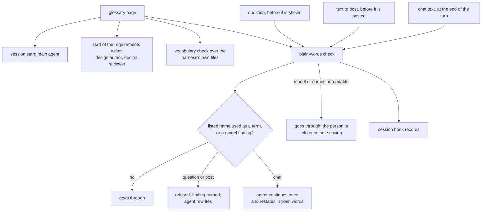

# Design: One vocabulary for the harness

**Ticket:** GH-166
**Date:** 2026-11-15
**Spec:** ai-docs/plans/2026-11-15-harness-vocabulary-glossary.spec.md

## Approach

The harness gets one `glossary page`, shipped with the method pages. Each concept has one entry: the name
the harness uses for it, the other names it has been called, one sentence on what it is, one on what it
does, written for someone who has never opened the harness's files, and the page and section that define
it — or, for a knowledge-base concept, that it is planned. Names whose concept is gone sit in a closing
table with what they used to name. The page opens with the rule for anything written to a person: the
description carries the meaning, in the person's language; the name appears at most as an untranslated
aside; no name is translated into a term or invented; a concept with no entry is described by what it
does, and a proposed entry goes into the pull request's description. The names are written in a fixed
form, so one shared `glossary name reader` takes them from the page for every check below; there is no
second list.

Five pieces of work surround the page.

1. **It is in context from the start, through the `glossary loading hooks`.** Beside the session-start
   hook that tells the agent to read the method page, the glossary itself enters the main agent's
   context, at the start and again after the context is compacted. The host cuts any one hook message
   over its size cap down to a file path and a short preview (the host's hook documentation; the cap is
   the host's own threshold), so the page goes in several messages, each under the cap, split between
   entries; enough are registered for a page at the size limit. Three agents get it too, because their writing reaches the owner as written or holds the
   rule there: the requirements writer, the design author and the design reviewer. Every harness agent is
   started as a general-purpose agent whose brief names its page, so the agent's type cannot tell them
   apart; a hook on the agent-starting tool appends the page to the brief of a start whose type or brief
   names one of the three.
2. **One sweep renames.** Every other name and retired name on the covered surfaces becomes the canonical
   name. A word with several senses keeps one, chosen below; the senses that were ordinary English — a
   branch of a script, a guard switched on, whitespace collapsed, a starting measurement — are rewritten
   in plain words and get no entry. A page, script, flag or per-task file whose own name carries a listed
   name is renamed and every reference moves.
3. **The `vocabulary check`** joins this repository's check list. It reads the listed names and every
   covered file and fails naming the file, the line and the name, with no exemption for quoting: the
   glossary page alone may carry them. In a script it skips the names the script gives its own variables
   and functions, an id mark, and a line carrying an `internals mark` that says why the old word must
   stay — text an earlier file carries and the script still reads, or a test's planted copy of it. It
   also refuses a glossary whose names collide. It reports which surfaces and how many files it read. A page it cannot
   read, one that yields no names, or a covered file it cannot read is a could-not-run, never a pass.
4. **The `plain-words check`** runs in every project using the harness, at the three moments the host
   allows: a question, before the question tool shows it; a text to post, before a posting command runs —
   which commands post, and which of their flags carry the text or name its file, is the project's
   `Posting commands row` in its profile; and the chat text of the main agent's turn, when the turn
   ends. Each text is read twice side by side: the listed names are matched outside quotation and code marks, and a model reads it
   with the glossary for three breaches — a name translated word for word and used as a term, a name
   invented for a concept, a harness name carrying the meaning with no plain description. A refused
   question or post names what was found, and the agent rewrites and retries; once the model alone has
   refused one in a turn, the model's reading refuses nothing more in that turn, while a listed name used
   as a term is refused every time. Chat text, already shown, makes the agent continue once and restate the
   affected sentences, asking nothing; the restatement is not read again. When the model or the names
   cannot be read, the text goes through and the person is told once per session that what the agent
   writes to them is not being checked. Every reading leaves a `plain-words record` among the session's
   hook records.
5. **The knowledge-base planning documents** kept outside the repository are rewritten with the canonical
   names when the task closes.

### The glossary, entry by entry

What the owner approves before the sweep. Each row is one entry; "Other names" are the names the sweep
replaces and both checks refuse, with their plural and verb forms. A dash means none.

#### Plans

| Canonical name | What it is | Other names |
|---|---|---|
| spec | a task's requirements: what the system must do, seen from outside, with numbered criteria | — |
| design | the document stating the approach chosen for a task, which the owner approves | "design doc" |
| plan | a task's spec and design taken together | "plan pair", "spec/design pair" |
| progress file | the task's working notes on the owner's machine, never committed: where it stands, its decisions, its review findings | "progress record", "working record" |
| plan freeze | the commit made when design review approves; every later change to the plan is measured from it | — |
| spec amendment | a change to the requirements the owner approves while the task runs | — |
| design amendment | a rewrite of the approach while the task runs, reviewed again and frozen again | — |
| earlier-shape design | a design written before the step list moved to the progress file; it carries its own list, and the length cap does not bind it | — |
| length cap | the soft limit the owner set on a design's length | — |
| working in the review notes | putting design review's notes into the design or the step list before the freeze | "fold-in", "folded in", "unfolded note" |
| cut-down spec | an archived spec that a since-removed last step cut down to three sections; the checks still recognise it, and the commit that made it, and skip both | "folded spec", "collapsed spec" |
| deliberate absence | what a spec records the task leaves out on purpose: out of scope, deferred, key decisions | — |
| plan archive | the folder of finished tasks' specs and designs, and the listing of it the whole-repository review reads | — |

#### Checking a plan

| Canonical name | What it is | Other names |
|---|---|---|
| convergence check | the script reading a spec and a design for six kinds of defect | "deterministic half" |
| completeness | the kind: every criterion is delivered by some step, every object has a use | — |
| arithmetic | the kind: a sum or count the plan states actually holds | — |
| provenance | the kind: every number says where it came from | — |
| reference | the kind: no reference to a line or position that goes stale | — |
| pairing | the kind: an id the plan cites matches the id beside the code, both ways | — |
| isolation | the kind: one fact is not repeated word for word in several places | — |
| holding class | a kind whose finding stops the design being handed back or approved | — |
| report-only | a check, or one kind of finding, that is shown and stops nothing | "advisory mode", "shadow mode" |
| contradiction reader | the AI reviewer reading a spec and a design for statements contradicting each other or existing files | "plan-convergence reader", "convergence reader", "judgement half", "judgement class" |
| record of accepted findings | the committed list of convergence findings a plan accepts as they stand | "record of excused findings", "excuse record", "excused convergence findings" |
| accepted finding | one row of that record: a finding kept visible with the reason it does no harm here, added only by an act that shows the finding first | "excuse", "excused finding", "waiver", "waived finding", "grant act", "excuse route" |
| record of declared links | the committed list of statement pairs in a plan that must change together, written by the design author | "link record" |
| declared link | one row of it: two quoted statements and why they move together | — |
| link check | the script telling, for each declared link, whether both statements still stand | — |
| record of accounted positions | a project's recorded list of line-number references that predate their ban; the reference kind reports only new ones | "baseline record", "positional baseline" |
| plan invariants | the fixed rules on what a spec and a design are and must contain, and the pages stating them | — |
| base principle | one numbered rule of the plan invariants | — |
| required element | a section a spec or a design must carry | — |
| protected page | a page that defines or enforces a required element | — |
| near miss | a page close to the protected set and deliberately outside it | — |
| plan-invariants guard | the hook asking before an edit changes a protected page, in a session improving the harness | "edit-time refusal" |
| learning mode | the state of a session that ran one of the workflows turning the Learning Log into rules | — |

#### Reviews

| Canonical name | What it is | Other names |
|---|---|---|
| design review | the sceptical review of a design before any code | "plan review" |
| design review verdict | GO approves, ITERATE sends back for rework, STOP rejects the approach | — |
| self-review | the review of the finished change against the spec, the design and the rules | — |
| self-review verdict | APPROVE: ready to push; REJECT: problems remain open | — |
| whole-repository review | the review of a whole branch's code rather than one change | "whole-branch review", "codebase review", "whole-codebase review" |
| checklist ledger | the table ending each self-review round, fingerprinting each file and rule reviewed, so the next round reviews only what changed | "review ledger" |
| review-fix round | after a REJECT: plan the fixes, check the plan, apply it, check the result, review again | "review-and-fix round", "scouted fix round", "scouted-plan sequence", "beat" for one of its steps |
| round baseline | the snapshot of the files when a review-fix round starts; the applied fixes are measured against it | — |
| fix plan | one row per open finding: what to change, where, and how much | — |
| fix-plan check | the script deciding whether a fix plan is applied, sent back or routed to an amendment | "plan arm", "routing arm", "applied arm", "post-apply arm", "size arm", "unplanned-file arm", "gate arm", "finding arm" |
| amendment trigger | two tests on a finding: Arm A, closing it would leave a spec or design sentence untrue; Arm B, the fix edits the spec or the design | — |
| correction row | a fix-plan row saying the shipped code departs from the design without breaking the approach | — |
| post-apply micro-loop | one question whether the applied change matches the plan, with a bounded number of re-fixes | — |
| human finding | a review comment, or a fix pushed after a pull request opened, counted to see what review missed | — |

#### Keeping files in step

| Canonical name | What it is | Other names |
|---|---|---|
| Propagation Rule | editing one instruction file means updating, in the same pull request, the files that describe the same thing | — |
| sync group | one named set of files the Propagation Rule keeps in step | — |
| propagation reminder | the hook naming a file's sync group when the agent edits it | — |
| path pattern | one file-path pattern the propagation reminder matches | "propagation arm", "reminder arm", "pre-fix arm" |

#### Learning Log

| Canonical name | What it is | Other names |
|---|---|---|
| Learning Log | the record of each instruction the agent broke, and the rule drawn from it | "corrections log", "corrections-log", "instruction-violation log", "learning record" |
| Learning Log archive | the file holding every entry once its branch merged | "learnings archive" |
| Learning Log fold | moving merged branches' entry files into the archive unchanged, then deleting them | — |
| promotion candidate | a lesson about the method itself, stripped of project names, kept for a sweep across projects | — |
| redaction gate | the check refusing a promotion candidate that names one project's material | — |

#### Checks and hooks

| Canonical name | What it is | Other names |
|---|---|---|
| gate | a check whose result decides whether work goes on | — |
| could-not-run | a check's result when it measured nothing; never a pass | — |
| positive control | a planted fault shown to be caught by the check meant to catch it | — |
| check list | this repository's checks, run together | "gate list" |
| check-list member | one check in the check list | — |
| touched-scope run | inside a loop, only the checks the changed files select | — |
| full run | the whole check list, once, after review approves | — |
| delivery gate | a check that what the plugin ships reaches a project: it installs, it upgrades, its version moved | — |
| result masking | hiding a gate's failure behind another command's success; a hook refuses its common shapes | "gate-pipe-guard" |
| gate record | the hook recording each gate run, with the state of the files it ran on | — |
| tree digest | a fingerprint of the files as version control sees them | — |
| fixture | a recorded real input a check replays, with the results it must reproduce, never refreshed casually | "frozen fixture" |
| loop ledger | the per-session file where the harness's hooks record each tool call and what they noticed | — |
| loop detector | the hooks flagging a repeated call, or one kind of call repeated within a turn | — |
| measurement setup | one of the setups a measurement compares | "measurement arm" |
| payload sibling | a file in another language that a shell script loads from its own folder | — |

#### The harness and a project

| Canonical name | What it is | Other names |
|---|---|---|
| method | the half of the harness that holds in every project | — |
| profile | a project's own half: its commands, language, permissions and facts | — |
| project registry | the list of projects set up with the harness, kept in the user's home folder | — |
| deployed configuration | files holding environment-specific settings, read only after asking | — |
| defect report | a report a project files back to the harness about a defect in it | — |

#### Knowledge base (planned, not yet part of the harness)

| Canonical name | What it is | Other names |
|---|---|---|
| knowledge base | a project's store of its current requirements, constraints and deliberate non-goals, one file per area | — |
| spec workflow | today's way of running a task, with a spec per task | "spec flow" |
| knowledge-base workflow | the planned way, where a task writes its requirements into the knowledge base | "card flow" |
| task document | the short committed document holding what a task does not leave in the knowledge base | "task card" |
| interview summary | what the owner approves after the interview, before the design | "interview card" |
| knowledge-base section | the section the harness writes into a pull request's description | "card", "merge card" |
| summary command | the command building the interview summary and the knowledge-base section | — |
| interview approval commit | the commit recording that the owner approved the interview summary | — |
| required CI check | the check a pull request must pass before it can merge | "merge gate" |
| new-conflicts-only blocking | a promoted check refusing only the conflicts a branch itself brings | "ratchet mode" |
| list of removed statements | the record of statements taken out of the knowledge base, with their reasons | "removed registry" |
| defaults list | the list of defaults the owner confirms in one answer | "the one block" |

#### This vocabulary

| Canonical name | What it is | Other names |
|---|---|---|
| glossary | the page holding one entry per harness concept | — |
| listed name | an other name or a retired name the glossary lists, which the checks refuse | — |
| vocabulary check | the check failing when a listed name appears in the harness's own files | — |
| plain-words check | the hooks reading what the agent writes to a person for listed names and coined words | — |
| internals mark | the comment marking a line of a script that must keep an old word | — |

#### Retired names

| Retired name | What it named |
|---|---|
| closing fold | the removed last step of a task, which applied the logged design changes to the design and cut the spec down |
| redline fold | the same step |
| redline log | the log of design changes that step applied, removed with it |
| correction log | the same log |
| redline | that log, and anything named after it |

### What changes its name

| Today | Becomes | Why |
|---|---|---|
| the Learning Log's field page, named after "corrections log" | the Learning Log page | an other name of the Learning Log |
| the spec-criteria check and its test, named after "redline" | the spec-criteria check | a retired name |
| the propagation reminder's check, its test and its check-list member, named after "arms" | named after path patterns | a sense "arm" loses |
| the convergence check's flag for accepting a finding, named after "excuse" | named after accepting | an other name of an accepted finding |
| the per-task record of accepted findings, named after "excuse" | named after accepting; a record under the old name is still read | an other name of the record |
| the result-masking hook's second name in the hook index | its one name | two names for one hook |
| headings carrying a listed name | the canonical name; every link to them moves | same |

## Key decisions

- **A word with several senses keeps the one it names most, where scripts read that sense in files.**
  *Fold* keeps the Learning Log fold: its test, its sync group and its contract carry it. *Arm* keeps Arm A
  and Arm B: fix plans already written carry them as a column the fix-plan check reads. *Baseline* keeps
  the round baseline, the fix-plan check's own step. *Freeze* keeps the plan freeze, including the plan's
  text as it stood then. *Card* is on no covered surface today, so all its senses go to knowledge-base
  entries. Rejected: retiring every such word — renames what scripts read in files written before the
  task, which changes what they do.
- **Ordinary English gets plain words, not entries**, and a generic word that heads several names — gate,
  record, ledger, archive, member — names nothing alone; the compound is the name. A spelling variant of a
  canonical name, such as "cannot run" for could-not-run, is that name. Rejected: entries for such uses —
  a page of non-concepts.
- **The refusal lists the qualified forms of an ordinary word**, never the bare word: "folded spec", not
  "folded". The sweep and review hold the bare word. Rejected: listing it bare — refuses prose.
- **One source.** Both checks read the names from the glossary through one shared reader. Rejected: a
  separate list file — two lists drift.
- **Quoting is a mention only in text for a person.** In the harness's files every appearance counts,
  because the glossary is where an old name lives on. Rejected: exempting quoted names in files — the
  sweep's leftovers would hide behind backticks.
- **Script words are skipped by kind, not by file**: names the script gives its own variables and
  functions, id marks, and marked lines. Rejected: a per-file allowance — it would hide a printed message
  in the same file; reading only comments and strings — misses unquoted shell text.
- **Entries are short.** About 100 entries (the rows of the tables above, rounded up) at about 290
  characters each — name 25, other names 30, two sentences 175, location 45, markup 15, an estimate from the
  entry's fields — plus about 2,500 for the rule and the retired names (estimated) come to about 31,500
  characters, below the 35,000-character early warning (a threshold the method hands down). Rejected: the
  spec's estimate of about 410 characters an entry — the page then holds about 85 entries, fewer than the
  required list.
- **Posting commands are declared in the project's profile**, as the deployed-configuration patterns are,
  because the method names no host or tool. A profile with no such row is a could-not-run for posts, told
  once per session. Rejected: matching a known tool — puts a host's name in the method.
- **The glossary reaches three agents by their brief**, appended at the start, and no others. Rejected:
  every agent at its start — pays the page on agents that write only for agents; by agent type — every
  harness agent starts under the same general-purpose type.
- **The model is called through the host's command-line client**, as the turn-end loop detector's optional
  stage already does, with a small model by default, a setting to change it, and a time limit the hook
  sets. The child call carries a marker that silences the harness's own hooks inside it. Rejected: no
  marker — the child session would load the glossary and run the turn-end check, calling the model again.
- **The chat text read is the whole turn's**: the transcript's assistant text since the person's last
  message, plus the final message the turn-end event carries, which the host says the transcript may not
  yet hold. Rejected: the final message alone — a coined name earlier in the turn is missed.
- **The hook records hold every reading**, finding or none, as a new record class, and the check's own row
  at each turn end bounds a turn. Rejected: a file of its own — a second session record; findings only —
  leaves nothing to count a rate against.
- **The record of accepted findings is read under both names and written under the new one**, so a task in
  progress keeps what it accepted; the `record of accepted findings` under its new name is the one file
  this task renames that a project already holds. Rejected: migrating the old file — changes a file nobody asked to change.

## Risks

- **Three files loaded whole sit close to the early warning**: the method page, the task skill and this
  repository's project context page, 814, 954 and 1,327 characters below it (measured by a character
  count of each file on this branch, 2026-11-15). Mitigation: in those files a canonical name is no longer
  than what it replaces where a shorter one exists; otherwise explanation moves to a page reached by link.
- **The glossary itself sits near the warning** by the estimate above, leaving little room for later
  entries. Mitigation: a later entry for one part of a concept already present merges into that entry.
- **The host's message cap, a denied question never being shown, and rewriting a brief at an agent's
  start** are the host's documented behaviour, not yet observed here (verify): each is exercised in this
  repository before the checks rely on it.
- **A false model finding costs one rewrite or one restatement**, never a block: the model's reading
  refuses at most once a turn, chat is restated at most once, and every reading is recorded so the rate can
  be counted.
- **Each turn end and each question or post waits for a model call**, bounded by the hook's time limit;
  over it the text goes through as a could-not-run.
- **The extra turn end a restatement adds** carries no tool call, so the loop detector sees an empty turn
  and reaches no verdict; the restatement is told to call no tool.
- **A project already using the harness has no posting-commands row**: posts there go unchecked, told once
  per session, until the project adds it.
- **The sweep can break a reference**: the reference check, the check list's inventory of named checks and
  the vocabulary check run over the result.

## Use cases

- `glossary page` — put into the main agent's context at session start and after compaction; appended to
  the brief of the requirements writer, the design author and the design reviewer; read by the vocabulary
  check and the plain-words check for the names; read by the model for the descriptions; read by a person
  asking what a harness word means.
- `glossary name reader` — gives both checks the canonical, other and retired names; refuses a page whose
  names are not in the fixed form.
- `glossary loading hooks` — at session start and after compaction, put the page into the main agent's
  context in pieces under the host's cap; at an agent start whose type or brief names one of the three
  agents, append the page to its brief; inside a model call made by a harness hook, do nothing.
- `vocabulary check` — in this repository's check list: fails on a listed name in a covered file, naming
  file, line and name; fails on a glossary listing one name twice, or a name as both canonical and other
  or retired; reports its surfaces and file count; reports a could-not-run on an unreadable page or file.
- `internals mark` — written on a script line that must keep an old word; read by the vocabulary check,
  which skips that line.
- `plain-words check` — before a question: refuses on a finding, or lets it through; before a declared
  posting command: refuses on a finding, or lets it through; at the end of the main agent's turn: makes the
  agent continue once to restate, or ends the turn; on any could-not-run: lets the text through and tells
  the person once per session.
- `Posting commands row` — declared in a project's profile; read by the plain-words check to know which
  commands post and where their text is.
- `plain-words record` — written at every reading, finding or none; read by the check for the
  once-per-turn and once-per-session bounds; read afterwards to count how often text was flagged.
- `record of accepted findings` — written under its new name by the accepting act; read by every run of
  the convergence check, together with a record under the old name.

## Collisions

- The method page's communication rule already forbids agent-internal words toward a person; that clause is
  replaced by a pointer to the glossary's rule rather than kept beside it.
- The requirements writer's list of words forbidden in a question restates part of the same rule; it points
  at the glossary instead of growing.
- The loop ledger's page enumerates its record classes; the new class is added there.
- The turn-end event gains a second hook. The loop detector there still never blocks; the plain-words check
  blocks at most once a turn.
- The knowledge-base ticket's spec draft in this repository carries listed names; it is out of scope, and
  that ticket's next requirements round rewrites it.

## Open questions

- None.
