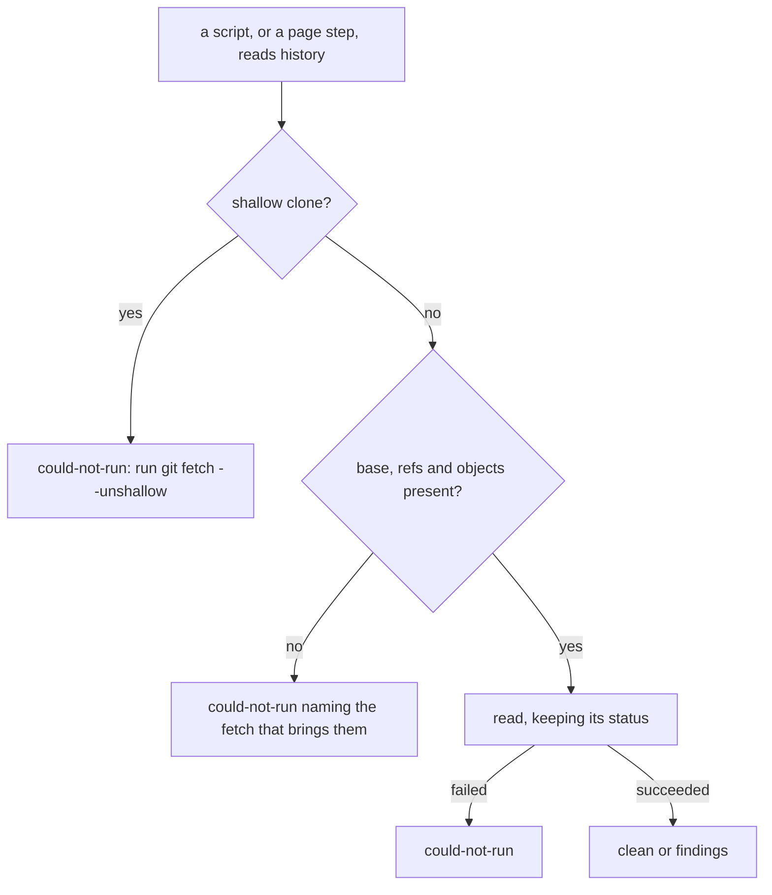

# Design: History and ref reads that answer wrongly

**Ticket:** GH-189
**Date:** 2026-11-20
**Spec:** ai-docs/plans/2026-11-20-history-and-ref-reads.spec.md
**Approved:** 1st approval, design review round 2, 2026-11-21

## Approach

In the scripts and page steps this task changes, a read that cannot answer stops as a could-not-run,
naming the command that cures it where one exists, instead of handing its caller an empty answer to read
as a fact. No script fetches. The exceptions to this rule and to the shallow refusal below, the hooks'
reads and the bugfix workflow's diff window, are in § Risks.

**Two shared pieces.**

- **The shallow refusal**, a new script, `scripts/full-history.sh`. Given a path, it asks version control
  whether the repository holding it is a shallow clone: with full history it passes silently; shallow, it
  stops as a could-not-run with one line — the clone is shallow, history beyond its depth is not here, run
  `git fetch --unshallow`; where version control cannot say, it is a could-not-run too. It never looks at
  its own location. The plan-freeze lookup, the checklist ledger and the release check run it first. The
  instruction pages run it before every walk of history they prescribe — the resume's lists of commits
  since a recorded commit, its tests of whether a recorded commit was rewritten or merged, the escalation
  audit's count of recent activity, the three-dot diff in the command reference — and before any plan
  freeze is committed. Two page reads that walk history only to learn what the head holds are rewritten
  to walk none: the interview's committed-spec test reads the head commit's tree, and the task page's
  check after branching compares the new branch's commit id with the default branch's.
- **A profile reader**, `hooks/lib/default-branch.sh`: the branch the `Default branch` row of the project's
  version-control table in `AGENTS.md` names, or nothing. Every read of the default branch below asks it
  first.

**Each read.**

- **Release check.** The change set runs from the fork point to the working tree, uncommitted work
  included, so a branch that changed nothing shipped passes whatever the tip's version. A base sharing no
  history with the branch is a could-not-run saying no fetch cures it. The base is confirmed present as a
  commit before any use, every read keeps its status, and a read failing on an object the clone lacks
  names that object and the fetch that brings it. The manifest's presence at the base is decided by
  listing the base's tree, so only a genuinely absent manifest reads as a first release. The version must
  be strictly above the tip's, each field compared as a number. A single-branch clone missing the default
  branch's ref is told `git remote set-branches --add origin <default> && git fetch origin <default>`. The
  helper that confirms a base is current refuses an absent commit given as is.
- **Freeze lookup.** Among the plan's freezes reachable from the head, it takes the one no other freeze of
  the plan descends from.
- **Branch protection** guards the branch either the profile or the remote's record names; with neither, the
  command passes with a notice saying how to name it.
- **Diff-range guard.** The base is the profile's default, else the remote's record, else `main`, resolved
  as the remote-tracking ref, else the local branch; only a successful read listing nothing blocks.
- **Check runner.** A member ending as could-not-run is counted as such, apart from failures; the run ends
  with findings over could-not-run over clean. A suite that detects its own could-not-run leg, with no leg
  failing, ends as could-not-run.
- **Gate record.** A background launch is recorded with its verdict unknown and matched by nothing; every
  unknown verdict's notice says so. A `cd` it cannot resolve, or a check script outside both the repository
  and the plugin, gives the row unknown files. Contradiction compares the whole argument list. A command
  that only reads a check script records no run, a shell started only to parse it included.
- **Smaller.** The Learning Log fold stops, naming the fetch, when the default branch's remote-tracking ref is
  absent, the branch chosen as the guard chooses it; a branch counts as pushed from its configured upstream
  or the remote's list of branches; the profile's merge style reads `merge-commit`; a fetch and adding a
  branch to the fetch list run unprompted, and `--upload-pack` in any abbreviation still asks.

## Key decisions

- **One refusal, given its target.** Rejected: each script testing depth itself — the rule copied per
  caller; testing the script's own location — a project runs the scripts from an installed copy with no
  history.
- **Those two page reads are rewritten, not refused.** Rejected: the refusal before them — a step more on
  the task page, near its size warning, for reads that, rewritten, answer in any clone.
- **The release check keeps reading the repository it ships from**, and hands that directory to the
  refusal: it is that repository's own delivery gate and runs nowhere else. Rejected: the working
  directory — a changed gate with no reader.
- **The release check's default base** ([release-base] in `scripts/check-release.sh`) is the profile's
  default, else the remote's record,
  else `main`, and the check refuses whenever the two name different branches, whatever base was passed,
  naming both and how to point the remote's record at the profile's branch, with the set-branches-and-fetch
  first when that branch's remote-tracking ref is absent. Rejected: refusing only the derived
  base — the criterion is unconditional.
- **Version order**: a missing field reads as zero; a field that is not a number is a could-not-run.
  Rejected: text order — it ranks a two-digit field below a one-digit one.
- **Every default-branch read takes the profile's branch first** — branch protection, the release check,
  the diff-range guard and the fold. Rejected: the remote's record alone for the guard and the fold — a
  clone of another working copy records that copy's branch, so the fold would compare against the wrong
  branch and the guard block a correct diff.
- **The unknown-default notice is shown to the person with no permission decision**, so a push still asks.
  Rejected: an allow decision — it skips that ask.
- **An unresolvable folder is recorded as unknown.** Rejected: interpreting assignments made earlier in
  the command inside the hook.
- **A background launch** is told by the tool input's `run_in_background` field, which the host's Bash
  tool declares in its input schema, else by the launch reply the host returns in place of a result; a
  gate ended by a lone `&` keeps its present reading. Rejected: the reply alone — its wording is the
  host's to change.
- **Two freezes neither of which descends from the other** are a could-not-compute naming both. Rejected:
  the newer by commit time — the reading this task replaces.

## Risks

- Every shallow checkout, a future CI checkout included, now refuses the release check, the freeze lookup
  and the checklist ledger: the refusal names the fetch, which runs unprompted, and loosening it is a
  separate open ticket.
- A clone whose remote's record is wrong refuses the release check even for an explicit base; the message
  names both branches and the remedy.
- Departures the spec makes. The bugfix workflow's diff window runs no shallow refusal: the spec puts it
  out of scope. The diff-range guard runs none: the spec's refusal binds scripts, page reads and freeze
  steps, and the guard blocks only on an empty list, meaning the head is reachable from the base, which a
  shallow cut, removing only ancestry, cannot fake. And three reads end without naming a fetch, as their
  criteria allow: on a failed read the guard stays silent or says the base did not resolve; branch
  protection, knowing no default, passes with its notice; the gate record writes a row with its files
  recorded as unknown.
- Four pages loaded whole at agent start are edited close to the instruction-size check's 35,000-character
  early warning, each size measured with `wc -m` on 2026-11-21 and its room being the warning less that
  size: the glossary 34,455 (545 left), the task page 34,040 (960 left), `ai-docs/context.md` 33,989
  (1,011 left), `agents/self-review.md` 33,004 (1,996 left). The glossary gains one short row, the task
  page swaps one phrase for one no longer, the other two rewrite sentences they hold, and the check reds at
  the warning, so no overrun passes unseen.

## Use cases

- `scripts/full-history.sh` — run first by the plan-freeze lookup, the checklist ledger and the release
  check on the repository each reads; run by the agent before each walk of history an instruction page
  prescribes and before committing a plan freeze; in a shallow clone it stops all of them with one line
  naming `git fetch --unshallow`; with full history it is silent; where version control cannot say, it is a
  could-not-run.
- `hooks/lib/default-branch.sh` — read by branch protection at every commit or push, to guard the profile's
  default beside the remote's record; read by the release check to derive its default base and to refuse
  when the remote's record names another branch; read by the diff-range guard to choose its base; read by
  the Learning Log fold to choose the branch whose copies it compares against. It prints nothing for a
  profile with no such row or a `%…%` value, which each caller reads as the profile naming none, and
  `main` for a newly scaffolded profile, whose template row says `main`.

## Collisions

- The knowledge-base work refuses shallow clones in its own tool by the same rule; when it lands it can call
  this refusal instead of carrying a second one.
- The bugfix workflow's diff window and the task's merged check already read the default branch from the
  profile's row, by hand; the reader is a second, scripted form of that read, and those pages keep theirs.

## Open questions

- None.
